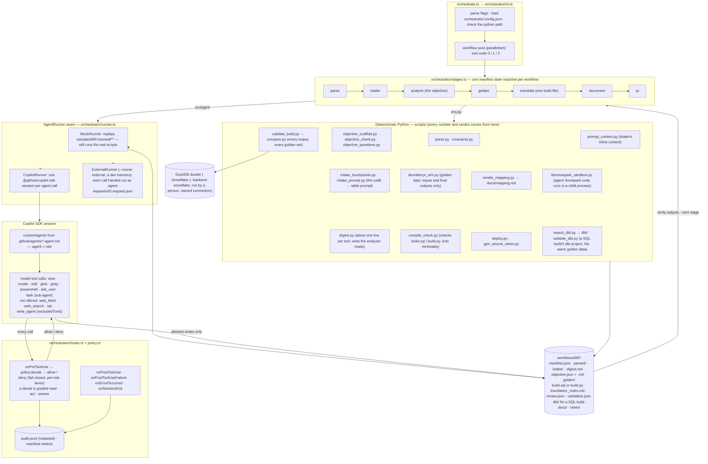
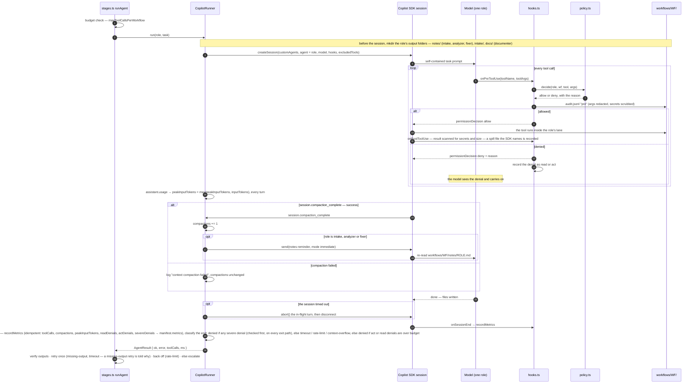
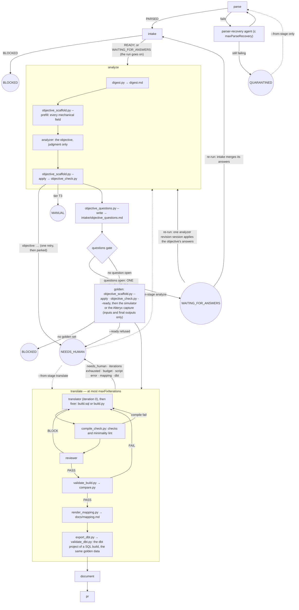
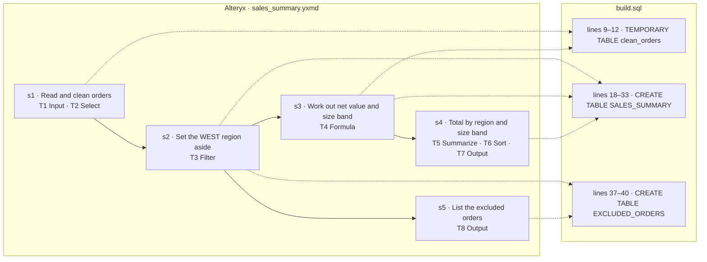

# Alteryx → Snowflake migration pipeline

## 1. What this is

An offline-first pipeline that turns an Alteryx workflow (`.yxmd`) into **one minimal Snowflake file**.
The file is `build.sql` (plain Snowflake SQL), or `build.py` (one Snowpark module) only when SQL cannot
express the logic. The pipeline proves the file against golden data and hands it over with documentation and
a generated map from the Alteryx steps to the lines of that file. A SQL workflow is also handed over as a
small **dbt project** (`workflows/<id>/dbt/`): not translated a second time but converted from the validated
`build.sql` by a script (`scripts/export_dbt.py`, never an agent) and checked against the same golden data
(`scripts/validate_dbt.py`). It is on by default; `program.dbt: false` in `mappings/global.yaml` turns it off,
and a Python workflow never has one.

It does not translate tool by tool. It first writes down the workflow's **objective**: what the workflow is
for, what each output must contain (grain, key, columns), the business steps with the Alteryx tool ids each
one covers, the rules, the Alteryx quirks to keep and the points it is unsure about. The build file is
written from that objective.

Deterministic Python scripts under `scripts/` do the parsing, the objective's mechanical fields and checks,
the compile check and minimality lint, the golden-data validation and the mapping. A TypeScript orchestrator
(`orchestrate.ts` / `orchestrator/*.ts`) drives a state machine over those scripts and **seven** GitHub
Copilot custom agents (`.github/agents/*.agent.md`, `orchestrator/types.ts`'s `Role`/`ROLES`: intake,
analyzer, translator, reviewer, fixer, parser-recovery, documenter). There are **eight** `.agent.md` files in
total. The eighth, `cookbook-curator`, is CLI-only: a human runs it directly through the Copilot CLI to
propose `cookbook/*.md` updates (never edited directly), and the orchestrator's state machine does not use
it. There is no validator agent. Validation is a script, `scripts/validate_build.py`, which the orchestrator
runs.

The scripts and the agents never call each other directly. The only interface between every piece is files
under `workflows/<wf_id>/`, so any stage can be re-run, inspected or replaced without touching the others.
The user's one explicit requirement beyond the written program spec is built in: **the pipeline asks a human
to name the Snowflake table for every `.yxdb` file (and every other input and output)**, and it never invents
one (`scripts/intake_prompt.py`, §5 below).

**What changed.** The first version of this pipeline translated tool by tool: it cut a workflow into segments
of 15–40 tools, wrote one stored procedure per segment with one CTE per Alteryx tool, tied them together with
a master procedure and work tables, offered a dbt target that an agent wrote, and had a validator agent. The
result was correct and far too large: the 8-tool sample `wf_0001` came to 194 lines of SQL plus a master
procedure. That design is removed, not kept as a fallback. (A dbt project is delivered again, but converted by a
script from the one validated file, never written by an agent.) The reasons and every rule of the new one are in
`docs/superpowers/specs/2026-10-06-objective-first-design.md`; the field-by-field references are
`docs/reference/objective.md` and `docs/reference/build-file.md`.

### Where it stands

- **Offline:** the objective-first pipeline has been run with the mock runner on the seven sample workflows,
  from parse to document (`wf_0005` is tier T3 and ends at `MANUAL`), and `workflows/` is that run's committed
  product (§6). To see what it makes, open `workflows/wf_0001/objective.md`, `workflows/wf_0001/build.sql` and
  `workflows/wf_0001/docs/mapping.md`. It has been tested with the node, `tsc` and pytest suites (nothing
  skipped — §4).
- **With a real model:** the earlier, segment-based pipeline ran end to end with a local 27B model served by
  `llama-server` through the real Copilot SDK, and with Claude Sonnet standing in through `--runner external`
  (`docs/live-smoke-test.md`, "Fourth live test"). The agent files, the orchestrator and most scripts were then
  rewritten for the objective-first flow, so those results do not carry over. The objective-first pipeline has been
  **re-run end to end with Claude Sonnet standing in for the model (`--runner external`, outside the Copilot SDK and its tool policy — docs/live-smoke-test.md, "Fifth live test"); not yet with the local model or a GitHub-hosted model**: the Fifth live test ran three samples (wf_0001, wf_0007, wf_0006) from intake to
  document, with the orchestrator's own checks real. The Copilot SDK path (`CopilotRunner` and its tool policy) has
  not run since the rewrite.
- **Not yet:** nothing has run on a real Snowflake account, a real Alteryx engine, or a GitHub-hosted model.
  `docs/handoff-production.md` is the step-by-step guide for doing that in the company's setting, and
  `docs/production-backlog.md` lists what only that setting can close.

### Architecture at a glance

Three diagrams, all drawn from the code as it stands (`orchestrator/*.ts`, `scripts/*.py`); the file names
are real. GitHub renders them inline.

**Components.** The CLI drives one manifest state machine per workflow. Deterministic Python does everything
that produces a number or a verdict — digesting the DAG, writing and checking the objective, compile-checking
and linting the build file, validating it against the golden data, rendering the mapping; agents are reached
only through the `AgentRunner` seam, and a Copilot session can touch the repo only through tool calls that the
hooks judge first.



**One agent call, through the hooks.** This is what `runAgent` in `stages.ts` does for every
role; the sub-agents a session spawns with `task` go through the same `onPreToolUse` (verified
live, `docs/live-smoke-test.md`). A mid-session context compaction sends a fixed notes-file
reminder to the three notes-keeping roles (intake, analyzer, fixer), and every `assistant.usage`
event tracks the call's peak input-token count. Since the live-hardening task (L1), the session's
runtime runs with the configured interpreter's directory first on `PATH`, so an agent's
`python scripts/<name>.py …` is the project's interpreter in any run root. This was verified live
in the fourth live test (`docs/live-smoke-test.md`): the system interpreter there has neither
`yaml` nor `duckdb`, and the intake agent's `python scripts/intake_touchpoints.py wf_0001` and
`python scripts/intake_prompt.py wf_0001 --no-interactive` both succeeded. Every task ends its
instructions with the same fixed seven session rules (fix round 2, L9 nit: this summary named only
the first four): relative paths; `glob`/`view`/`grep`; only its own workflow; a refused call is
final; (L7) never read this pipeline's own `scripts/`/`orchestrator/` source to debug a difference;
(L8) never read the golden data in bulk, one set's inputs at most; (L9) there is no network in these
sessions. A spill file the SDK names in one of the session's own results becomes readable
(`view`/`grep` only). A read that could cover another workflow is refused. Denials are graded: a `severe` one (another
workflow, the pipeline's own files, the network, SQL outside the sandbox, destructive commands) parks the
stage at once; `read` and `act` denials are refused and counted, and park the stage only past their budgets
(`budgets.maxReadDenialsPerSession`, `budgets.maxActDenialsPerSession`, 20 each). On a timeout the in-flight
turn is aborted first, and a timed-out session is kept when the stage's own check passes on what it left on disk;
the translator's and the fixer's session is kept only if its build file also changed during that session (a file an
earlier attempt left does not count).



**Stages and where a workflow can park.** Success states are skipped on re-runs; parked states
(double circles) are never re-executed by a plain run and reopen only with `--from-stage`.
Intake no longer stops the run when it has questions: the run goes on to analyze, and stops after it with
**one** notice for every open question — intake's table-mapping questions and the objective's own
(`intake/open_questions.md`, `intake/objective_questions.md`). Analyze writes the objective: `digest.py`
digests the DAG, `objective_scaffold.py` pre-fills every mechanical field, the analyzer adds the judgment,
and `objective_scaffold.py --apply` and `objective_check.py` hold the result to every rule
(`docs/reference/objective.md`). Translate is one loop for the whole workflow: the translator (then the fixer)
writes the one build file, `compile_check.py` checks and lints it, the reviewer reads it, and
`validate_build.py` — a script the orchestrator runs, never an agent — compares every output with the golden
data; on a PASS `render_mapping.py` writes `docs/mapping.md`, and a SQL workflow's `build.sql` is converted by
`export_dbt.py` into a dbt project that `validate_dbt.py` runs against the same golden data (exit 1 of either
parks translate at `dbt: <the first line of the script's stderr>`; exit 2 is a `script-error`).



### One build file per workflow

| | `build.sql` | `build.py` |
|---|---|---|
| When | the objective's `language` is `sql` — every workflow whose logic SQL expresses well | `language` is `python`, with a reason — a Python tool, or logic SQL cannot express well |
| What | plain Snowflake SQL: one write statement per output, CTEs or temporary tables only where they remove repetition or help reading | one Snowpark module, `def main(session, src, tgt) -> str` |
| Inputs and outputs | only `{{src}}.<LOGICAL>` and `{{tgt}}.<LOGICAL>`, the objective's logical names | `session.table(f"{src}.<LOGICAL>")` and `.write.mode(…).save_as_table(f"{tgt}.<LOGICAL>")` |
| Steps | a `-- step s1` comment starts the region of an objective step | a `# step s1` comment |
| Checked by | `compile_check.py` — named checks, an empty-sandbox run, and a minimality lint | `compile_check.py` — the Snowpark static rules, then a sandboxed run on empty inputs |
| Validated by | `validate_build.py` on DuckDB, every output against its golden file, every golden set | `validate_build.py` through the Snowpark Local Testing Framework, inside the sandbox |
| Deployed as | one file, run by `EXECUTE IMMEDIATE FROM @<stage>/build.sql USING (src => …, tgt => …)` | one Python stored procedure (handler `main`) that `deploy.py` wraps around it |

The objective, not the Alteryx canvas, is the unit of work. `workflows/<id>/objective.json` holds the
mechanical fields the orchestrator derives (ids, logical names, column names and types, write modes, PreSQL and
PostSQL, merge keys) and the judgment the analyzer adds (purpose, each output's grain and key, the steps with the
tool ids each covers, the rules, the parity risks, the language and tier, and the questions it is unsure
about); `objective.md` is the same facts for a person. **A person sees only what the analyzer is unsure about**:
those questions (`O1`, `O2`, …) are asked in the same sitting as intake's table-mapping questions, and one
analyzer session applies the answers before the run goes on. Every tool of the workflow must be cited by a step
or listed as having no effect on data.

**Minimal, and checked.** The translator is told to write the least code that produces each output exactly:
one write statement per output, never a CTE per tool. `compile_check.py` lints the file (`pass_through_cte`,
`tool_by_tool`, `single_use_chain` in `compile_check.json`); a flag is fixed or justified in
`translation_notes.md` as `lint <kind> <name>: kept because <reason>`, and the reviewer blocks one that is
neither. The lint never fails a build by itself, and a rule it cannot see (a CTE that is a real filter in
disguise, or one that really helps reading) stays a judgment for the reviewer.

**The map.** `scripts/render_mapping.py <wf>` writes `workflows/<id>/docs/mapping.md` from `objective.json`, the
step markers in the build file and `parsed/dag.json`: a Mermaid diagram of the business steps (with their tool
ids) against line ranges of the file, and a table of every Alteryx tool with its step and its lines. It exits 1
if a step has no region or a tool is not accounted for. The block below is the diagram it wrote for `wf_0001`,
copied from `workflows/wf_0001/docs/mapping.md`, which also holds the table of every tool (design §4.9).



**The dbt project.** A SQL workflow is also delivered as `workflows/<id>/dbt/`, written by
`scripts/export_dbt.py <wf>` from the validated `build.sql` — by code, so it is the same logic, not a second
translation. A temporary table becomes an `ephemeral` model, an overwrite output a `table`, an append an
incremental `append`, an `update_insert` an incremental `merge` on the objective's keys, a TRUNCATE-then-INSERT a
`table`, and an Output tool's PreSQL and PostSQL that model's `pre_hook` and `post_hook`; `{{src}}.X` becomes
`{{ source('<wf>', 'X') }}`, a temporary table `{{ ref('t') }}`, and each model keeps the build's own SQL text and
starts with the step markers it sits under. The project is `dbt_project.yml`, `profiles.yml` (a local DuckDB
target, and a commented Snowflake template with placeholders only), `README.md`, `models/sources.yml`,
`models/schema.yml` (the objective's column meanings, `not_null` for every NOT NULL column, `unique` for a
one-column key, all as warnings) and one model per output and per temporary table; `docs/reference/build-file.md`, "dbt export",
has the conversion table. A statement with no dbt form is exit 1 naming its line. `scripts/validate_dbt.py <wf>`
runs the project on every golden set with dbt-duckdb (`dbt build`: the models, then the tests) and compares each
output through the same `compare.py`, writing `dbt/validation.json` in `validation.json`'s shape, idempotency
included; the files in `dbt/` stay Snowflake SQL, and the run is on a copy whose models are translated to DuckDB
the way `validate_build.py` translates the build. **The project has only run on that DuckDB double**, never on
Snowflake. After `render_mapping.py` the orchestrator runs both scripts; a Python workflow, and a run with
`program.dbt: false`, skip them with nothing written.

**Deploying.** `scripts/deploy.py <wf> --database DB --schema SCHEMA` is a dry run by default and connects to
nothing: for a `build.sql` it prints the `PUT` of the file to a stage, the `EXECUTE IMMEDIATE FROM … USING
(src => …, tgt => …)` that runs it (Snowflake's own templating fills `{{src}}` and `{{tgt}}`) and a commented
`CREATE TASK`; for a `build.py` it prints the one `CREATE PROCEDURE` and the `CALL`; with `--dbt` it prints
instead the one `dbt build --project-dir workflows/<id>/dbt --profiles-dir <your profiles dir> --target <name>`
command, with the `--vars` for `src_schema` and `tgt_schema`, to run with your own Snowflake profile (it runs
nothing, and refuses a workflow with no `dbt/`). Only a `VALIDATED`
workflow deploys. The source schema is the view schema `scripts/gen_source_views.py` generates, one view per
logical source, so the file never names a production table. **The templated `EXECUTE IMMEDIATE FROM … USING`
form has not run on any account**; `--render` also writes `build.rendered.sql` with the schema names
substituted, for an account where it does not.

Taking the pipeline to a real Snowflake account, the company's real Alteryx corpus and GitHub-hosted models is
the production hand-off: `docs/handoff-production.md`, written for the agent that does it.

## 2. Honesty note — read this before anything else

**Nothing in this repository has run against a real Snowflake account or a real Alteryx engine.**
Every external system is reached through an interface with a real (unexercised) implementation and
a local double behind the same seam:

| External system | Real implementation | Local double actually used here |
|---|---|---|
| Snowflake | `SnowflakeBackend` (`scripts/lib/backend.py`) — a thin, never-run pass-through | `DuckDBBackend`: Snowflake-dialect SQL, parsed and transpiled by `sqlglot`, executed on DuckDB |
| Alteryx engine | `AlteryxEngineCmd.exe` (never available on this machine) | `scripts/dev/alteryx_sim.py`, a hand-written interpreter documented in `docs/reference/simulator-semantics.md` |
| Copilot agents | `CopilotRunner` (the real `@github/copilot-sdk`, exercised in live tests of the earlier pipeline only; the objective-first pipeline has run with Claude Sonnet standing in through `--runner external`, outside the SDK — see §3's BYOK note) | `MockRunner`, which replays hand-written artifacts under `samples/<wf>/canned/**` |

Two consequences follow directly from this:

- **Golden data is simulator output, not Alteryx output.** `compare.py`/`validate_build.py` prove
  that a translated build file agrees with `scripts/dev/alteryx_sim.py`'s model of Alteryx — not
  with Alteryx itself. The simulator's rules are written from the dag contract, the program spec
  and public documentation, never from an observed run; every rule in
  `docs/reference/simulator-semantics.md` is tagged `(assumption — verify per Alteryx version)`
  except a handful of measured facts about this repo's own arithmetic. The single largest known
  parity risk is documented there in full (§1.1): the simulator computes formula arithmetic in
  **exact decimal**, while real Alteryx computes `Double` values in **IEEE-754 binary64** — the two
  disagree on a measured 0.67% of random rounding cases. This is a genuine, quantified gap between
  what this repo proves and what a real Alteryx engine would do, not a rounding error to be tuned
  away.
- **What a `VALIDATED` workflow in `workflows/` actually shows:** the build file, run on DuckDB (a
  `build.py` in the Snowpark Local Testing Framework), writes every output with the same rows (within
  the configured tolerances) as the simulator's model of the same workflow, across four golden sets
  (`normal`, `period_end`, `empty`, `edge`), and is idempotent from the same starting state. It does **not** show that the SQL matches what a real Alteryx run
  or a real Snowflake account would produce. Every doc in this repo that could be misread that way
  says so again at the point it matters. A SQL workflow's `dbt/` project is held to the same standard and
  no more: it ran on DuckDB through `dbt-duckdb` (a copy of its models translated to DuckDB SQL, as
  `validate_build.py` translates the build), never on Snowflake.

The live tests are documented honestly in `docs/live-smoke-test.md` — see §3 and §11 below for what they
did and did not prove. The first four drove a **real** GitHub Copilot CLI/SDK session against a **real** local
model (or had Claude Sonnet stand in through `--runner external`) on the earlier, segment-based pipeline. The
fifth is the objective-first pipeline, re-run end to end with Claude Sonnet standing in for the model (`--runner external`, outside the Copilot SDK and its tool policy — docs/live-smoke-test.md, "Fifth live test"); not yet with the local model or a GitHub-hosted model.

## 3. Prerequisites and setup (Windows, as built)

```bash
# Python 3.14, project-local venv (never install into the system Python)
python -m venv .venv
.venv/Scripts/python.exe -m pip install -r requirements.txt   # duckdb, sqlglot, pyyaml, pytest, snowpark, dbt-core, dbt-duckdb

# Node 22 via fnm — the system default here is 20.18, too old for the Copilot SDK
# (package.json: "engines": { "node": ">=22.12.0" })
fnm install 22
fnm exec --using=22 npm.cmd ci

# GitHub Copilot CLI (needed only for --runner copilot; --runner mock needs neither this nor login).
# Needs PowerShell 6+ (this build used 7.6.6) for its own shell tool.
fnm exec --using=22 npm.cmd install -g @github/copilot
fnm exec --using=22 copilot.cmd --version
```

`fnm` installed through WinGet lives at `%LOCALAPPDATA%\Microsoft\WinGet\Links\fnm.exe`; on
Windows, `fnm exec` spawns without shell resolution, so `npm`/`copilot` must be invoked as
`npm.cmd`/`copilot.cmd`. `gh` (the GitHub CLI) is optional, and GitHub integration is OFF unless
`orchestrator.config.json` sets `"github": {"enabled": true}` or a run passes `--gh`: off, the
orchestrator never invokes `gh` (no issue for open questions, no pull request) and logs
`gh: disabled`; on but not installed, it logs `gh not installed` (see `announceQuestions` and `stagePr` in
`orchestrator/stages.ts`).

**Optional: a local BYOK model, for the `local` profile / `--runner copilot`.** This repo's own
live tests used `scripts/dev/serve_model.ps1` (a loopback-only `llama-server` launcher for a
PrismML llama.cpp fork serving `Ternary-Bonsai-2-27B-PQ2_0.gguf`, with `-CacheTypeK`/`-CacheTypeV`
KV-cache quantization flags, on by default since fix round 1 below) against
`orchestrator.config.json`'s `profiles.local`, pointed at `http://127.0.0.1:8080/v1`. **Full
results, both what worked and what did not across the live tests, are in `docs/live-smoke-test.md`** —
summarized in §11 below. This step is optional: every number in this README's §4 and every worked
example in `workflows/` comes from `--runner mock`, which needs no model, no login and no network
at all.

Live hardening (Task L7, R1): a live end-to-end run against `llama-server`, run with `-c 262144` and the
default 4 parallel slots, overflowed its context — the server logged `Context size has been exceeded`
at `n_tokens = 98490` and the SDK logged `translator context compaction failed` — because the SDK did
not know this BYOK model's own limits and compacted too late. At 4 slots this build ran ONE unified
262144-token cache shared by every slot: the SDK's own background compaction request (~140k tokens)
landed beside the main conversation (~98k) in that same shared pool, and the two together exceeded it.
It is **passing `-np` at all** that changes this, not how many slots you ask for (fix round 1 review,
M1: this build's own help text says the unified, shared-cache mode is the default only "if number of
slots is auto", i.e. only when `-np` is omitted) — `serve_model.ps1` always passes `-np` explicitly, so
it is never in that mode. On this build, `-c 262144 -np 2` reports `n_slots=2, n_ctx_slot=131072,
kv_unified=false`: the context is SPLIT evenly, a fixed, independent 131072-token allocation per slot,
not one shared pool, so the session's own conversation and the SDK's background compaction request
each get their own budget instead of competing for one.

Live hardening fix round 1 (R-c, R-d): `serve_model.ps1`'s defaults (`-Context 262144 -Parallel 2
-CacheTypeK q4_0 -CacheTypeV q4_0`) ARE the setup the committed `orchestrator.config.json`'s
`profiles.local.provider.maxPromptTokens` (**100000**, not the fix round 0 value of 120000 — see
below) is sized against; running the script with no flags at all now matches the committed config,
which it did not before this fix round (the old default `-Context` was 32768, a quarter of what
100000 alone would need). If you run a different `-Context`/`-Parallel` (a different GPU), lower
`maxPromptTokens` to match: the script itself prints `n_ctx_slot = Context / Parallel` and a
`maxPromptTokens` that fits it (about 77% of `n_ctx_slot`) on every run, and — when it can read
`orchestrator.config.json` — warns if the configured value exceeds THAT FIT, not the raw per-slot
budget (fix round 2, L7-m3: comparing against the raw slot let 120000 print "fits" even though the
wf_0007 probe is exactly what proved it overflows), and says why not when it can't read the file at
all. **Why not closer to the SDK's own 80% compaction threshold:** a live run of the earlier pipeline's dbt workflow (the
wf_0007 probe) with `maxPromptTokens: 120000` against this same 131072-token slot reached **131095
tokens with ZERO compactions**. Fix round 2 (L7-m4) corrects the first-round reasoning here: if the
SDK's background-compaction (80%) and blocking (95%) thresholds are both relative to
`maxPromptTokens`, as this repo assumes, a 131095-token request with no compaction at all means the
SDK's own token estimate was under roughly 114000 — at least ~15% below the real count, or, if
compaction never even started, as much as ~37% below it. 100000 (`≈ 131072 × 0.77`) is a plausible,
conservative pull-back from 120000 under that range, not a value proven safe by the 9% figure fix
round 1 first used. The real check going forward is `CopilotRunner`'s own log line (this run's actual
`maxPromptTokens`/`maxOutputTokens`/model, once per session start) together with `assistant.usage`'s
`peakInputTokens` (recorded per role in a workflow's `manifest.json`, `metrics.<role>.peakInputTokens`)
on the next long session — that ratio is the real number 77% only estimates.

`orchestrator.config.json`'s `profiles.local.provider.maxPromptTokens` tells the SDK's `createSession`
(the SDK's `ProviderConfig.maxPromptTokens`, `node_modules/@github/copilot-sdk/dist/types.d.ts`) the
prompt budget to compact against; the SDK's own default background-compaction threshold is 80% of
that budget (`InfiniteSessionConfig.backgroundCompactionThreshold`, same file), so at 100000 the main
conversation is compacted at roughly 80k tokens — comfortably inside its own slot's 131072. `maxOutputTokens`
is still unset (fix round 1 review, M2): 100000 leaves 31072 tokens of headroom above `maxPromptTokens`
itself (131072 − 100000), and 51072 tokens above the SDK's own 80%-of-100000 compaction point (131072 −
80000) — either way, judged enough margin without also guessing a cap on the model's own output length
untested here, though (L7-m4) that margin is not independently measured, only estimated. The hosted
profile sets neither `maxPromptTokens` nor `maxOutputTokens`: the SDK already knows Copilot's own
models' limits.

## 4. Running the tests

```bash
.venv/Scripts/python.exe -m pytest                 # Python: parser, objective, build-file checks, intake, compare, …
.venv/Scripts/python.exe -m pytest -m e2e           # the slower end-to-end subset: every sample's canned build and dbt project against its golden sets
fnm exec --using=22 node.exe --experimental-strip-types --test orchestrator/test/*.test.ts   # orchestrator
fnm exec --using=22 node.exe node_modules/typescript/bin/tsc --noEmit -p .                     # types
```

Expected result for all four: **all pass, zero skips.** (`pytest -m e2e` selects the tests that run
every sample's canned build (`validate_build.py`) and its dbt project (`validate_dbt.py`) against every golden
set of that sample; they are a subset already included in the first, plain `pytest` run, broken out here
because they are the slowest part.) No count is written here — a hard-coded one would drift the next time any
of these tests change; each command prints its own at the end of a run.

## 5. Running the pipeline interactively — the yxdb-to-table prompt

This is the user's one explicit requirement beyond the written spec: **the pipeline asks the user
to name the Snowflake table for every `.yxdb` file (and every other input and output)**, proposing
a default, and it never invents an answer. `scripts/intake_prompt.py` is real, deterministic
Python — not an agent — and doubles as the backing implementation for the SDK's `ask_user` handler
in a live session. What follows is a **real transcript**, captured from an actual run of
`scripts/intake_prompt.py wf_0001 --interactive` in a scratch root (seeded from `samples/wf_0001`,
outside the tracked `workflows/wf_0001`), with the answers below piped into its real stdin (a
piped stdin does not echo, so the typed answer is shown inline where the terminal would have
printed it):

```
$ .venv/Scripts/python.exe scripts/intake_prompt.py wf_0001 --interactive --user wf_owner --root <scratch>
wf_0001 - sales_summary.yxmd
2 yxdb files found: orders.yxdb (tool 1, input), sales_summary.yxdb (tool 7, output)
Does this workflow depend on other .yxdb files that are not visible in the DAG (for example
written by another workflow)? [y/N]: n
Q1 - Tool 1 Input Data reads C:\data\sales\orders.yxdb (7 fields, 20 rows)
  1) SALES.RAW.ORDERS             7/7 columns - 1,204,551 rows
  2) SALES.RAW.ORDERS_ARCHIVE     6/7 columns (missing STATUS)
  3) ANALYTICS.RAW.ORDERS         naming convention -- not verified to exist
Snowflake table [1] (Enter=accept | number | DB.SCHEMA.TABLE | ?=defer | !=cannot exist in
Snowflake): [Enter]
Q2 - Tool 7 Output Data writes C:\data\out\sales_summary.yxdb (6 fields), mode overwrite
  1) ANALYTICS.CURATED.SALES_SUMMARY naming convention -- not verified to exist
Snowflake table [defer] (Enter=defer | number | DB.SCHEMA.TABLE | ?=defer | !=cannot exist in
Snowflake): ANALYTICS.CURATED.SALES_SUMMARY
Write mode [overwrite] (overwrite/append/merge): [Enter]
Q3 - Tool 8 Output Data writes C:\data\out\excluded_orders.csv (7 fields), mode overwrite
  1) ANALYTICS.CURATED.EXCLUDED_ORDERS naming convention -- not verified to exist
Snowflake table [defer] (Enter=defer | number | DB.SCHEMA.TABLE | ?=defer | !=cannot exist in
Snowflake): ANALYTICS.CURATED.EXCLUDED_ORDERS
Write mode [overwrite] (overwrite/append/merge): [Enter]
wf_0001: intake READY
```

Note what happened on each answer: candidate 1 for Q1 (`SALES.RAW.ORDERS`) was a **full** column
match, so a plain Enter accepted it; neither output candidate was a full match (each is a
naming-convention guess, "not verified to exist"), so Enter there means **defer**, not accept — the
FQN had to be typed explicitly. This asymmetry is deliberate (`intake_prompt._enter_accepts`): a
careless Enter must never let an output silently land on an unverified guess.

The resulting `intake/mappings.yaml` of that session (contract C6 — every source and output
carries a `logical:` name; the build file reads each source as `{{src}}.<LOGICAL>` and writes each
target as `{{tgt}}.<LOGICAL>`, and the schema names are filled in only when the file is run). The committed
`workflows/wf_0001/intake/mappings.yaml` holds the same names and tables with `confirmed_by: automation`,
because the offline run of §6 answers non-interactively:

```yaml
sources:
  sales/orders.yxdb:
    snowflake: SALES.RAW.ORDERS
    logical: ORDERS
    tool_ids: ['1']
    confirmed_by: wf_owner
outputs:
  out/sales_summary.yxdb:
    snowflake: ANALYTICS.CURATED.SALES_SUMMARY
    logical: SALES_SUMMARY
    tool_ids: ['7']
    confirmed_by: wf_owner
    mode: overwrite
    keys: []
  out/excluded_orders.csv:
    snowflake: ANALYTICS.CURATED.EXCLUDED_ORDERS
    logical: EXCLUDED_ORDERS
    tool_ids: ['8']
    confirmed_by: wf_owner
    mode: overwrite
    keys: []
```

This session also **promotes** every one of these three mappings into the program-wide
`mappings/global.yaml`, so a later workflow that reads the same source or writes the same target
resolves it without asking again. Promotion happens here because a real `--user wf_owner` confirmed
them interactively; it is intended, reviewed program state to commit, so it is deliberately NOT
what happens for a non-interactive resume under the default `automation` identity (§6 shows that
case, and why `mappings/global.yaml` stays untouched there).

To reproduce this yourself without disturbing the committed `workflows/wf_0001`, run it in a
scratch root:

```bash
SCRATCH=/path/outside/this/repo
.venv/Scripts/python.exe scripts/dev/build_samples.py seed --only wf_0001 --root "$SCRATCH" --samples "$(pwd)/samples"
cp -r mappings catalog "$SCRATCH/"
.venv/Scripts/python.exe scripts/parse.py wf_0001 --root "$SCRATCH" --check
.venv/Scripts/python.exe scripts/intake_touchpoints.py wf_0001 --root "$SCRATCH"
.venv/Scripts/python.exe scripts/intake_prompt.py wf_0001 --interactive --root "$SCRATCH"
```

The orchestrator runs this same prompt itself whenever stdin is a real TTY (`--interactive`, the
default off a TTY is `--no-interactive`); in a live Copilot session the identical prompt logic
backs the SDK's `onUserInputRequest` handler, so the intake agent can ask the same question through
`ask_user` (`orchestrator/runner.ts`'s `CopilotRunner.answer`) — unattended, that handler reports
the user is unavailable rather than blocking forever. Off a TTY, intake records its open questions in
`intake/open_questions.md` and the run goes on through analyze, which may add its own
(`intake/objective_questions.md`, §1); the run then stops once, with ONE notice naming every open
question file, in the log — and only with GitHub integration on (`--gh`, or `github.enabled` in
`orchestrator.config.json`) as one GitHub issue holding both files.

## 6. The offline end-to-end run, and what `workflows/` shows

**The seven sample workflows under `workflows/` are the committed PRODUCT of running this exact
sequence once — they are not something you need to (re-)generate.** On a fresh clone, `workflows/`
is already there, already at the terminal states in the table further down: nothing in this
section needs to be run just to *see* the worked examples. What follows is how to reproduce that
same sequence yourself — to watch it happen, to extend it, or to add a new sample (§7) — **in a
SCRATCH ROOT, the same way §5's reproduction does**, so a reader following along never disturbs
the committed `workflows/` tree or leaves a stray file in this repository. (An earlier run that
used `--root .`, the repo root itself, had to revert by hand the `mappings/global.yaml` promotion
that running there causes; running in scratch instead avoids that class of side effect entirely.)

Every real script really runs and every SQL statement really executes on DuckDB; only the
orchestrator-driven Copilot agents (§1) are replayed from hand-written canned artifacts
(`--runner mock`): per sample, `canned/objective.json`, `objective.md`, `build.sql` (or `build.py`),
`translation_notes.md`, `review.json`, `docs/migration.md` and `intake/plan.md`. This run calls intake, the
analyzer, the translator, the reviewer and the documenter, and the parser-recovery agent for `wf_0005`; no fixer
is called, because every canned build is the correct one ("The fixer loop" below runs one). The sequence, adapted to
a scratch root:

```bash
SCRATCH=/path/outside/this/repo
mkdir -p "$SCRATCH"
# orchestrate.ts spawns every Python call with cwd=--root (`orchestrator/cli.ts`'s `env.py`), so a
# relative script path like `scripts/parse.py` has to exist under "$SCRATCH" too, not just under
# this repo; mappings/catalog are intake's own program-wide answers (same reason as §5).
cp -r scripts mappings catalog "$SCRATCH/"
# "python"/"samplesDir" resolve against --root by default (`path.resolve(root, config.python)`),
# so a scratch orchestrator.config.json needs them absolute -- this repo's real venv and samples/,
# not copies, since only scripts/ actually has to exist under "$SCRATCH" itself. A --runner copilot
# session gets that interpreter's directory first on PATH (`sessionEnvironment`, orchestrator/cli.ts),
# so the agents' own `python scripts/<name>.py …` runs this venv, not the system Python.
# In Git Bash `pwd` prints /c/Users/…, which Node on Windows cannot resolve; `pwd -W` prints the
# drive-letter form C:/Users/…. (The orchestrator refuses to start if this path does not exist.)
REPO="$(pwd -W 2>/dev/null || pwd)"
printf '{"python": "%s/.venv/Scripts/python.exe", "samplesDir": "%s/samples"}' "$REPO" "$REPO" \
  > "$SCRATCH/orchestrator.config.json"

# 1. Seed every sample workflow's source and golden inputs
.venv/Scripts/python.exe scripts/dev/build_samples.py seed --root "$SCRATCH" --samples "$REPO/samples"

# 2. First pass: intake records its questions and the run goes on through analyze (the objective), then
#    stops at the questions gate with ONE notice per workflow naming every open question file
#    (wf_0005's parser-recovery replay — see below — also happens inline in this same pass). This writes
#    scripts/parsers/ext/acme_dedupe.py and tests/parser_corpus/acme_dedupe/ under "$SCRATCH" —
#    the root the run used — never into this repository's own tracked tree.
fnm exec --using=22 node.exe --experimental-strip-types orchestrate.ts --root "$SCRATCH" --runner mock --no-interactive

# 3. Feed each sample's recorded answers into manifest.answers (a stand-in for a human checking
#    the boxes in intake/open_questions.md)
.venv/Scripts/python.exe scripts/dev/answer_samples.py --root "$SCRATCH" --samples "$REPO/samples"

# 4. Second pass: reaches the terminal states
fnm exec --using=22 node.exe --experimental-strip-types orchestrate.ts --root "$SCRATCH" --runner mock --no-interactive

# 5. A third pass changes nothing but each manifest's updated_at (idempotent re-run)
fnm exec --using=22 node.exe --experimental-strip-types orchestrate.ts --root "$SCRATCH" --runner mock --no-interactive
```

**Nothing here promotes an answer into `mappings/global.yaml`.** Step 4's `intake_prompt.py
--no-interactive` resumes under the default `automation` identity (§5 explains the default), and
promotion to the program-wide `mappings/global.yaml` — intended, reviewed state to commit — only
ever happens for an interactive session or an explicit `--user <name>`, never for that default.
Every workflow's own `intake/mappings.yaml` still gets the resolved sources and outputs (recorded
`confirmed_by: automation`); no answer is promoted into `mappings/global.yaml` by this whole
sequence, which is exactly why the committed one still parses to nothing but its own
program/session/tolerances values (`tests/test_foundations.py`). (The scratch root's own copy of the
file comes out of the sequence byte for byte as it went in: `lib/io.py`'s `write_global_mappings` keeps
everything above `sources:` verbatim, comments included, and nothing was promoted into the tail.)

Every stage writes into `workflows/<id>/`: `parse.py` → `parsed/dag.json`; `intake_touchpoints.py`
+ `intake_prompt.py` + the intake agent → `intake/`; `digest.py` → `digest.md`;
`objective_scaffold.py`, the analyzer agent, `objective_check.py` and `objective_questions.py` →
`objective.json`, `objective.md`, `intake/objective_questions.md`; `alteryx_sim.py` → `golden/` (inputs and
final outputs only); the translator, fixer and reviewer agents and `compile_check.py` / `validate_build.py`
(real scripts) → `build.sql` (or `build.py`), `translation_notes.md`, `fix_log.md`, `compile_check.json`,
`review.json`, `validation*.json`; `render_mapping.py` → `docs/mapping.md`; `export_dbt.py` and
`validate_dbt.py` (a SQL workflow only) → `dbt/` and `dbt/validation*.json`; the documenter agent →
`docs/migration.md`.

**Terminal states** (`workflows/<id>/manifest.json.status`):

| workflow | tier | language | parse | intake | analyze | golden | translate |
|---|---|---|---|---|---|---|---|
| wf_0001 | T1 | sql | PARSED | READY | DONE | DONE | **VALIDATED** |
| wf_0002 | T1 | sql | PARSED | READY | DONE | DONE | **VALIDATED** |
| wf_0003 | T1 | sql | PARSED | READY | DONE | DONE | **VALIDATED** |
| wf_0004 | T1 | sql | PARSED | READY | DONE | DONE | **VALIDATED** |
| wf_0005 | T3 | sql (nothing is written) | PARSED | READY | DONE | *(never runs — T3)* | **MANUAL** |
| wf_0006 | T2 | python | PARSED | READY | DONE | DONE | **VALIDATED** (a `build.py`) |
| wf_0007 | T1 | sql | PARSED | READY | DONE | DONE | **VALIDATED** (one output is an `update_insert` `MERGE`) |

**The worked SQL example is `workflows/wf_0001/`.** `objective.md` says what the workflow is for in plain
words (the sales summary by region and size band, and the orders it leaves out); `objective.json` carries the
same facts with each output's grain, key and columns, and the steps with the tool ids each covers;
`build.sql` is the one file the translator wrote from it, with a `-- step sN` marker for every step;
`translation_notes.md` records the assumptions; `compile_check.json` is the compile check and lint verdict;
`review.json` the reviewer's; `validation.json` and `validation.<set>.json` the comparison of every output
with every golden set; and `docs/mapping.md` the generated map from the steps and tool ids to the line ranges of
`build.sql`.

**The worked Python example is `workflows/wf_0006/`.** Its Python tool made the analyzer set the objective's
`language` to `python`, with the reason it wrote into `objective.json`'s `language_reason`: the tool carries a
deferred balance from one row to the next inside a customer, and `min(carried + billed, cap)` does not distribute
over a running sum, so no SQL window function expresses it (`cookbook/snowpark.md`). The translator therefore
wrote `build.py` (one module, `main(session, src, tgt)`, `# step sN` markers) instead of a `build.sql`;
`compile_check.py` ran its static rules and then ran it in the
sandbox on empty inputs, and `validate_build.py` ran it against the golden sets in the Snowpark Local
Testing Framework, not DuckDB — `validation.json` carries `"language": "python"` for that reason.

wf_0005 stops at `MANUAL`: its `run_command` tool is tier T3 for the analyzer (the objective is still written,
in full), so `golden`/`document`/`pr` simply never apply — `analyze --> MANUAL: tier T3` is a dead end in the
spec's own state diagram.

**Reproducing the product.** Run from a `git archive` export of this repository in a scratch root
(its own `workflows/` deleted first), the sequence above rebuilds every committed file under
`workflows/`; `diff -rq -x audit.jsonl -x '*.duckdb' -x '*.duckdb.wal' -x logs` against it lists only
files whose `validation*.json` (`dbt/`'s too) `runtime_ms` (each validation's own wall clock) or
`manifest.json` `updated_at` differ, and with those two fields normalised the diff is empty.

wf_0005's `unknown` vendor plugin (`AcmeAnalytics.Dedupe.DedupeTool`, a deliberate invention — see
`samples/wf_0005/README.md`) triggers the **parser-recovery** path: `scripts/parse.py --check`
fails invariant 8 (`unknown tools without a behavior: 1 of 4 data nodes`, over the 10% ceiling), the
parser-recovery agent writes a diagnosis plus an extension (`scripts/parsers/ext/acme_dedupe.py`
and a regression fixture) that explains — but does not decide the meaning of — the tool, and the
re-parse succeeds (`manifest.json.parse = {"attempts": 2, ...}`). **That extension and its
regression fixture are deliberately not committed here** — see the `.gitignore` entry next to
`/scripts/parsers/ext/acme_dedupe.py` for why (in short: committing it would make `parse.py`'s
`DEFAULT_EXT_DIR` auto-load it on every future run, so wf_0005 would stop failing on its first
parse attempt and stop exercising the very path it exists to test). `workflows/wf_0005/parsed/`
still carries the diagnosis (`parse_diagnosis.md`) as evidence of what the recovery agent found.

**Re-running.** Every stage is idempotent: a success state (`TERMINAL_GOOD` in
`orchestrator/stages.ts`) is skipped outright. An **escalated** stage — `NEEDS_HUMAN`,
`QUARANTINED` or `BLOCKED` — is **parked**: a plain re-run does not re-execute it or anything after
it, and prints the resume command; only an explicit `--from-stage <stage> [--only <wf>]` reopens
it and everything after it. `WAITING_FOR_ANSWERS` is the one non-terminal state that **does**
re-run its own deterministic scripts on every pass, specifically so newly-given answers get merged
in without re-asking what is already settled: intake's resume merges its answers, and a resumed analyze
refreshes the typed objective answers (`objective_questions.py --write`) and, once every `O…` question is
answered, runs one analyzer revision session that applies them to the objective.

**The tool-call budget is one specific, recurring reason a workflow parks at `NEEDS_HUMAN`.**
`orchestrator.config.json`'s `budgets.maxToolCallsPerWorkflow` (default 400) is a per-workflow
ceiling that accumulates across every agent session that workflow has ever run, not per attempt —
`toolCallsUsed` (`orchestrator/stages.ts`) sums `toolCalls` out of every role in
`manifest.metrics`, which persists on disk between runs. Crossing it before a role even starts
parks that stage `NEEDS_HUMAN` with reason `budget`, exactly like any other escalation above:
a plain re-run will not retry it. An explicit `--from-stage <stage>` both reopens the stage and
grants it a fresh budget for what follows. The budget must be a positive integer, and
`budgets.maxReadDenialsPerSession` and `budgets.maxActDenialsPerSession` non-negative integers.
Anything else is a configuration error: the orchestrator exits 2 naming the key, before any
workflow runs.

**A denied tool call parks the stage at once when it was severe; other refusals are budgeted.**
Every refused call is still refused, and every denial carries a class (`orchestrator/POLICY.md`,
"Denial classes"):
- `severe` — it tried to reach outside the session's workflow or the sandbox, or to do damage: any
  SQL-tool denial (but not the SDK's own `sql` todo store, an `act`); a call refused because it names
  another workflow, in any spelling Windows reads as one (`workflows./wf_0002/…`,
  `WORKFL~1\wf_0002\…`) — a broad read that could reach one is a `read`; a path that starts at the
  home directory (`~/.ssh/…`); a write — through a write tool, an `apply_patch` header, a shell
  command (`Set-Content`, `Out-File`, `Remove-Item`, `Copy-Item`'s destination, `>`, …) or a
  script's `--out`/`--db` path flag — to the own workflow's `golden/` or `audit.jsonl`, into
  another workflow, into the pipeline's own trees (`scripts/`, `orchestrator/`, `.github/`,
  `mappings/`, `catalog/`, `cookbook/`, `docs/`, `tests/`, `samples/`, …), onto one of its top-level
  files (`orchestrator.config.json`, `README.md`, `pyproject.toml`, `conftest.py`, …) or out of the
  repository; a destructive command (a `format` only as the disk command) or a recursive/forced
  delete; a script given `--root` or a Snowflake-account flag; an external location; a shell command
  — or input typed into a running shell — that names a network tool (`curl`, `Invoke-WebRequest`,
  `ssh`, `ping`, `tnc`, `git clone`/`fetch`/`pull`, a `python -c` importing `urllib.request`/
  `requests`/`socket`, a UNC share `\\host\share`, …), a package installer (`pip install`,
  `npm install`, `npx`, `uv add`, `Install-Module`, `winget install`, …) or a credential store
  (`$env:`, `Get-Credential`, `printenv`, `~/.ssh`, `.snowflake/connections.toml`, …); an unknown
  tool whose name says it reaches the network or deletes (`web_fetch`, `delete_file`, …); two
  command keys on a shell call, or a path key beside a `grep`/`glob`'s `paths`. A search's own
  literal pattern, a write's content and a planning tool's text are text, not a reach:
  `Select-String 'env:'` or `grep -rn curl scripts` is not severe, and a write is judged by its
  target (`orchestrator/POLICY.md`, item 8).
- `read` — a refused call of a tool that only reads (`view`, `grep`, `glob`, `read`, `read_file`,
  `ls`, `list_directory`, `search`, `search_files`, `find`, and the SDK's `read_`/`list_`
  shell-session tools), a refused `git status`/`git diff`/`git log` with only its own flags, or a
  refused shell command whose every statement starts with a read-only cmdlet (`Get-ChildItem`,
  `Get-Content`, `Select-String`, `Test-Path`, …) and holds none of `{`, `}`, `$(`, `@(`, `>`, a
  backtick, `[`, `&`, `Invoke-` or `iex`. For the PowerShell tool quotes are PowerShell's: a `|`,
  `;`, `(`, `[` or `{` inside them is text, so `Get-Content x | Select-String -Pattern "def (a|b)"`
  is a read.
  A `grep`/`glob` with a lone `path`/`file`/`dir` key instead of `paths` is a `read` too, and its
  reason says to use `paths`; so is a Windows alias that names no other workflow.
- `act` — every other attempted action: an interpreter one-liner, a command the role may not run, a
  chained command, a write inside the own workflow but outside the role's lane, a NEW scratch file
  at the run root (`_diag.py`), a shell call whose one command key is not `command`, an unknown tool.

  **A live translator's session, as an example (earlier pipeline).** On the end-to-end run of wf_0001 a
  translator made 173 calls. It wrote two throwaway DuckDB probes at the run root, `_diag.py` and `diag.py`,
  both refused; it tried three `python -c` one-liners, the validation script's `--help` twice and a
  `cd …; python …` chain; and it made seven refused reads (a `grep` with no path, `glob *`, a view of
  the run root, …). Under the first cut of Task L6 the two root files were severe and would have
  parked it at the first. They are scratch files, not the pipeline's: now they are two of 8 `act`
  denials, with 7 `read` denials — both within their budgets, so the session is judged by the
  translation it wrote. Had it written the same probe to `scripts/_diag.py`, or overwritten
  `orchestrator.config.json`, that one write would have parked it at once.

One `severe` denial ends the session as `denied`, which parks the stage `NEEDS_HUMAN` at once,
as the program spec says — whatever else ended the session: a severe attempt followed by a timeout,
a rate limit or a context overflow is still `denied`, never retried, and never kept by Task L7's
rule that keeps a timed-out session whose output passes its check (design doc §4, deviation 14).
More than `budgets.maxActDenialsPerSession` (default 20) `act` denials end it as `denied` too, with
the reason `act-denials: <n> over the budget of <m>; …`, and so do more than `budgets.maxReadDenialsPerSession` (default 20) `read` denials
(`read-denials: <n> over the budget of <m>; …`). The budgets catch a session that thrashes; within
both, the session's outcome is decided as if nothing had been denied, and the stage's own verify
callbacks and scripts judge what it wrote. (A live translator whose SQL passed all four golden sets
made 33 blocked attempts, about twenty of them stopping a shell it had started itself, which is
allowed now.) An act budget of 0 restores the spec's rule for every attempted action. This is a
deviation from the spec (§9, item 11). Each session's counts are summed into
`manifest.metrics.<role>.readDenials` / `.actDenials` / `.severeDenials`, and one log line per
session names all three. Every denial is still in `workflows/<wf>/audit.jsonl`, written before the
decision returns, and its `pre` line carries the reason and the class. The other retries are
unchanged: one identical retry for `missing-output` or `timeout`, a back-off for `rate-limit`, and
none for `context-overflow` or `denied`.

**The fixer loop, with the mock runner.** None of the six canned builds (`wf_0005` has none: it is tier T3) needs
a fixer — each one is the correct build — so the mock runner has a scenario for it: `--scenario fix-loop` serves one of
`samples/<wf>/broken/`'s deliberately broken whole-file builds on the translator's first attempt, and
`samples/<wf>/canned/`'s real one from the fixer's second attempt onward:

```bash
fnm exec --using=22 node.exe --experimental-strip-types orchestrate.ts --root <scratch> \
    --only wf_0001 --runner mock --scenario fix-loop --no-interactive
```

A broken build does not have to fail `compile_check.py` (it can be valid SQL that is simply wrong): then it
fails the **real** `scripts/validate_build.py` run against the golden data, and `migrateBuild`
(`orchestrator/stages.ts`) loops to the fixer role for iteration 1, which serves the correct build. The
fixer appends `workflows/wf_0001/fix_log.md` (`## iteration 1`, the symptom, the fix, the status); only which
file the mock served on each iteration is scripted (and the reviewer's verdict, which is the canned
`review.json`) — the compile check, the validation and the mapping that follows a PASS all run for real. (A transcript of this run is not reproduced here: it
has not been captured since the objective-first change.)

## 7. Adding a real workflow

**In the company's setting, follow `docs/handoff-production.md` §3 instead of the short form below**
(it adds the corpus survey, real golden capture with `inject_outputs.py` and the review), and work
through `docs/production-backlog.md`, its first-week checklist, first.

There is no capture tool here (no Alteryx engine), so this is a manual step:

1. Put the workflow's `.yxmd` (and any `.yxmc` macros, referenced under the same relative paths it
   uses) under `workflows/<wf_id>/source/`. `scripts/parse.py` scrubs connection strings and
   passwords from this XML on parse — nothing else here does that, so start from an export that
   has not already leaked one into a comment.
2. `manifest.json` does not need to exist first — `load_manifest` (`scripts/lib/io.py`) returns a
   default shape and every script fills in more of it as it runs.
3. Run the pipeline against just this workflow:
   ```bash
   fnm exec --using=22 node.exe --experimental-strip-types orchestrate.ts --root <run root> --only <wf_id> --interactive --runner copilot --profile local
   ```
   `<run root>` is a directory outside this repository, built as `docs/handoff-production.md` §0.3
   shows (never the repo root); the workflow goes under `<run root>/workflows/<wf_id>/source/`.
   `--interactive` puts a real human at the yxdb-to-table prompt (§5); `--runner copilot` and
   `--profile local`/`hosted` select a real Copilot session instead of the mock (needs the
   prerequisites in §3). The run stops once, after analyze, with one notice for every open question
   (`intake/open_questions.md` and `intake/objective_questions.md`); answer them and run again. Use
   `--dry-run` first to see which stages would run without doing
   anything (`plannedStages` in `orchestrator/stages.ts`). The run touches no GitHub remote: an
   issue for open questions and a pull request after `document` happen only with `--gh` (or
   `github.enabled`), which publishes and so needs the owner's approval.
4. Anything the analyzer marks manual, or any `unknown` tool the parser-recovery agent cannot
   explain, stays `NEEDS_HUMAN`/`QUARANTINED`/`MANUAL` — see the re-running paragraph in §6 for how
   to resume once a human has acted.

## 8. Switching to a real Snowflake backend, and the hosted Copilot profile

The procedure for both is `docs/handoff-production.md` §1 (hosted models) and §2 (Snowflake access:
grants, the named connection, the sandbox, `--backend snowflake`, `deploy.py`); this section is the
background.

**Backend.** Every SQL operation goes through `scripts/lib/backend.py`'s `SqlBackend` seam
(`translate`, `execute`, `query`, `load_table`, `create_view`, `table_exists`, `table_columns`,
`close`). `SnowflakeBackend` already implements it — a thin pass-through plus
`snowflake-connector-python` — but it is **untested code**: nothing in this repo has run it against
an account. It takes only the NAME of an entry in your own `connections.toml` (never a password or
any other connection argument), `validate_build.py` reaches it with `--backend snowflake`, run by a
human (`docs/reference/snowflake-backend.md`), and every one of its methods needs its own
verification pass (the module docstring names two known DuckDB-vs-Snowflake differences —
`VARCHAR(n)` length enforcement and identifier casing — that a real account will NOT paper over the
way DuckDB does).

**Snowflake objects.** `snowflake/*.sql` are DDL templates, every one headed with "NOT executed
against any Snowflake account; review and adapt before running this against a real account":
`01_ops_tables.sql` (`OPS.RUN_LOG`, `OPS.RECON_RESULTS`), `02_shadow_table_template.sql` (one
shadow table per migrated target), `03_reconciliation_task_template.sql` (compares shadow vs.
production on a schedule), `04_alerts.sql` (fires on a reconciliation `FAIL`), `05_roles.sql`
(`MIGRATION_AGENT`/`MIGRATION_CI`/`MIGRATION_RUN` and their grants; an older template, written before
`validate_build.py` could reach Snowflake — `--backend snowflake` and `deploy.py` need the grants of
`docs/reference/snowflake-backend.md` §5).

**Deploying a build file.** `scripts/deploy.py <wf> --database DB --schema SCHEMA` (§1, "Deploying")
is a dry run that prints what would be done and connects to nothing; `--execute` runs it through
`scripts/lib/snowflake_conn.py` and has never been exercised against an account here (it is tested with
fakes). For a `build.sql` the deployable is the file itself, put on a stage and run by `EXECUTE IMMEDIATE
FROM @<stage>/build.sql USING (src => …, tgt => …)`, which fills `{{src}}` and `{{tgt}}` with Snowflake's
own templating. Before running that on a real account:

1. **The templated form is unverified.** No account has run `EXECUTE IMMEDIATE FROM … USING` with this
   file. If it does not run on yours, `deploy.py --render` also writes `build.rendered.sql` with the schema
   names substituted; run that instead.
2. **The source schema is a set of views.** `scripts/gen_source_views.py` generates, per workflow, one view
   per logical source in a view schema (`<DB>.MIG_SRC_<WF>`) over the real tables, so the file never names a
   production table; create them first (`docs/handoff-production.md` §2).
3. **`ALTER SESSION`.** The file's first statement sets `TIMEZONE` and `WEEK_START`; whether
   `EXECUTE IMMEDIATE FROM` accepts it, in a Task or outside one, has not been checked.

For a `build.py` (a `"language": "python"` objective) the deployable is one Python stored procedure that
`deploy.py` prints around the module (handler `main`, arguments for the source and target schemas) with its
`RUNTIME_VERSION` — from `mappings/global.yaml`'s `program.snowpark_runtime`, currently `"3.11"` — and its
`PACKAGES`. Confirm your account offers that runtime and that the packages resolve in its Anaconda channel,
and add any further import the module uses. Local validation of a `build.py` used the Snowpark Local Testing
Framework, which implements a subset of Snowflake's functions and types, has no `session.sql`, and resolves no
real `RUNTIME_VERSION` or `PACKAGES`: a local `PASS` says the logic matched the golden data, not that the
procedure will create or run on your account (`cookbook/snowpark.md`, "What the local double does not
prove"). Only a workflow whose translate stage is `VALIDATED` deploys, under `MIGRATION_CI` — see the next
paragraph.

**Deploying the dbt project instead.** A SQL workflow with a `dbt/` project can be run through dbt rather than
as a stage file: `scripts/deploy.py <wf> --database DB --schema SCHEMA --dbt` prints the one `dbt build`
command, and you run it with your own profile (`dbt-snowflake` is not in `requirements.txt` and nothing here
connects with it; `docs/handoff-production.md` §2 has the steps). The project has run only on DuckDB through
`dbt-duckdb`: dbt's own `merge` strategy, `ephemeral` models, hooks and tests have never run against
Snowflake, and the first-run behaviour of an incremental model on a missing table is the one dbt documents, not
one this repository checked.

**The policy hook is defence in depth, not the primary boundary.** `orchestrator/policy.ts` is a
conservative textual check with no real SQL or shell parser — see `orchestrator/POLICY.md`'s own
"It is defence in depth, not a sandbox" section for its documented blind spots. **The primary
boundary is the Snowflake role**: no agent session in this repository connects to Snowflake and no MCP
server is configured here (`docs/handoff-production.md` lists one as not built); if the company puts one
behind its agents, the role it connects as should be like `MIGRATION_AGENT` — `USAGE` on
`MIG_WORK`/`MIG_GOLDEN`, read on the catalog, and nothing on production. A build file is not a procedure (a `build.py` is wrapped in one by `deploy.py`), so it
carries no `EXECUTE AS` choice of its own: which role runs it on a real account is decided at
deployment (§9, item 1; `docs/handoff-production.md` §2). Deploying is also a separate
role (`MIGRATION_CI`) from the one agent sessions run under, and nothing is deployed from an agent
session at all — agents produce files and a PR; a human or CI merges it.

**Hosted Copilot profile.** `orchestrator.config.json`'s `profiles.hosted` maps roles to
`gpt-6-astra`/`gpt-5.6-luna` per the program spec's own split (the `local` BYOK profile collapses
every role onto one model, since a local server only ever serves one). Run with `--profile hosted`;
`copilot`'s own login (`copilot /login` or `gh auth login`) is the user's own step — this repo never
attempts it and does not recommend it as a substitute for the context-window finding in
`docs/live-smoke-test.md` (summarized in §11). **Hand-off for the hosted profile:**
`docs/handoff-copilot-models.md` covers the owner's model policy (Luna Max by default, the 1M-token
context tier only for the roles that need it, no automatic escalation), where every model id is
chosen in this repo, `scripts/dev/list_models.ts` for reading the real catalog, `scripts/dev/set_models.py`
and the `--check-models` preflight (per-role context tiers are implemented), and the first-run
procedure.

## 9. Deviations from the program spec

(Full detail of the first build's deviations is in `docs/superpowers/specs/2026-09-18-alteryx-snowflake-pipeline-design.md`
§4. Items 15–17, and the rewrites of items 1, 2, 3, 5, 12 and 14, come from the objective-first change,
`docs/superpowers/specs/2026-10-06-objective-first-design.md`.)

1. **No stored procedures, so no `EXECUTE AS` choice in the SQL.** The spec's production runtime defaults
   to owner's-rights procedures, and the first version of this build made every procedure `EXECUTE AS
   CALLER` because an owner's-rights procedure cannot run `ALTER SESSION` (needed here to set
   `TIMEZONE`/`WEEK_START`). A `build.sql` is run by `EXECUTE IMMEDIATE FROM`, so that choice is gone;
   whether `EXECUTE IMMEDIATE FROM` accepts `ALTER SESSION`, in a Task or outside one, has not been checked
   on any account, and which role runs a build is decided at deployment. A `build.py` is wrapped in one
   Python procedure by `deploy.py`: read what it prints before running it.
2. **Logical names behind two placeholders.** A workflow can read two production schemas, and golden
   tables are named differently from production ones, so a build file references only a *logical* name
   behind `{{src}}` and `{{tgt}}` (`scripts/gen_source_views.py` builds the source views from
   `mappings.yaml`, one per logical source, in the schema `{{src}}` stands for); the schemas are filled in
   when the file is run.
3. **A multi-output objective.** A workflow can write more than one output (a Join's L/J/R, or two Output
   tools), so `objective.json` has an `outputs[]` list, one entry per output with its own grain, key, columns,
   ordering and tolerances; `compare.py` reads each through `lib/objective.py`'s `contract_view` and is
   unchanged.
4. **Agents are loaded by the orchestrator, not auto-discovered by the SDK.** `orchestrator/agents.ts`
   parses `.github/agents/*.agent.md` frontmatter + body and passes them as `customAgents`,
   selecting one per session with `agent: <role>`. The `.agent.md` files stay the single source for
   both interactive CLI use and the SDK.
5. **`compare.py` pre-labels diff classes** deterministically, so the M1 exit criterion ("the right
   cluster class") does not depend on an agent. There is no validator agent to refine the label (item 15):
   the fixer reads the labels as the script wrote them.
6. **CSV goldens with a `.schema.json` sidecar**, not Parquet — diffable in code review, no
   `pyarrow` dependency.
7. **Idempotency means determinism, not "safe to run twice blind".** The program spec's own phrase
   is "run twice on the same golden set"; an `append` output legitimately doubles on a second run
   without a reset, in real Alteryx too. The actual check here: two runs from the *same starting
   state* must produce byte-identical output (see §6's "Re-running" and the reproducibility check
   in `docs/superpowers/build-reports/2026-09-18-pipeline/task-17-report.md`).
8. **Row-scope and schema-scope differences are never approvable, and neither are `GOLDEN_DATA` or
   `UNKNOWN` at any scope.** `compare.py`'s `_approved` only ever signs off a cluster whose scope
   is `"columns"` with a non-empty column list — a missing/extra row, a duplicated key or a schema
   failure is always `FAIL`. On top of that, `GOLDEN_DATA` (a fault in the reference data itself,
   such as a NOT NULL violation sitting in the golden data) and `UNKNOWN` (which by definition
   names nothing a human could be signing off on) are refused regardless of scope — no signature
   over a translation difference can repair broken reference data or explain an unclassified one.
9. **Keyless streams are classified by nearest-match pairing** — a heuristic, not an exact
   correspondence, used only when a stream has no declared key to join golden and actual rows on,
   or when its declared keys repeat in the golden rows (live hardening, Task L11): the analyzer
   declares keys as a judgment, a real Alteryx output may repeat an id, and a key that does not
   identify a row cannot join anything. Such a stream is compared exactly as a keyless one, and its
   report carries the advisory `checks.keys_not_unique` (never a failure, never `needs_human` by
   itself) and a note that the contract's keys should be revisited. It used to be a `GOLDEN_DATA`
   cluster with `needs_human`, which parked a correct translation in a live run.
10. **GitHub is opt-in.** The spec's issue and pull request happen only with `--gh` or
    `github.enabled: true`; otherwise (the default) the orchestrator never invokes `gh`, logs
    `gh: disabled` and skips them, exactly as when `gh` is not installed; workflow status is
    unaffected (`announceQuestions`/`stagePr` in `orchestrator/stages.ts`).
11. **A denied tool call aborts the stage at once only when it was severe; other refusals are
    budgeted.** The spec says "tool denied by policy → log, abort stage, NEEDS_HUMAN". That rule
    holds at once for every `severe` denial, whatever else ends the session (a timeout, a rate
    limit): a call that tried to reach outside its workflow or the sandbox (SQL, another workflow in
    any spelling, the home directory, a write into another workflow, into the pipeline's own files or
    out of the repository, a network tool, an installer, a credential store, `--root`, a backend
    flag) or to do damage (a destructive command, a recursive delete, a write to the answer key or
    the audit). It holds for other attempted actions (`act`: an interpreter one-liner, a command the
    role may not run, a write inside the own workflow outside the role's lane, a new scratch file at
    the run root, an unknown tool) beyond `budgets.maxActDenialsPerSession`
    (default 20), and for blocked reads beyond `budgets.maxReadDenialsPerSession` (default 20). Every
    refused call is still refused, recorded in the audit and counted in `manifest.metrics`.
    The reason: a refused call has no effect, and every output is verified afterwards. The live
    evidence (Task L1) is the three phase-2 intake sessions (`docs/live-smoke-test.md`, "Third live
    test"). Each wrote `plan.md` and `mappings.yaml` and was then parked `denied`. 33 of their 54
    denials were refused reads. The 21 attempted actions were the notes-directory attempts that
    Task N1 removes. Task L6 added the end-to-end run of wf_0001: its analyzer's contract passed
    the orchestrator's own checks, and the session still parked on three `act` denials —
    a `Select-String` search misread as an action because of a `|` inside its quoted pattern (now
    a read), an interpreter one-liner, and an edit of intake's `open_questions.md` inside its own
    workflow. Under Task L6 it would have been judged by its outputs. A later live translator on
    wf_0001 wrote SQL that passed all four golden sets and made 33 blocked attempts, about twenty of
    them `stop_powershell` on its own shell; so `stop_*` is allowed now, and the act budget is 20
    like the read budget. The end-to-end run's translator (§6, "A live translator's session, as an example") also
    wrote two throwaway probes at the run root; a new scratch file there is an `act`, while a write
    into the pipeline's own files parks at once (L6 fix round 2). See "A denied tool call parks the
    stage…" in §6.
12. **An objective's mechanical fields are generated, not written by the analyzer.** The spec's analyzer
    writes all of its output. Here `scripts/objective_scaffold.py` derives every field that follows from the
    parsed DAG and `mappings.yaml` (ids, logical names, column names and types, write modes, PreSQL and
    PostSQL, merge keys), pre-fills it before the analyzer and re-applies it after; the analyzer decides only
    judgment (purpose, grain, keys, steps, rules, parity risks, language, questions), and
    `scripts/objective_check.py` gates every objective before golden (`docs/reference/objective.md`). The
    live evidence is from the segment contracts the objective replaces, and the same split carried over: a
    real model's analyzer got six mechanical fields wrong and nothing caught them.
13. **A retry after a missing output is told why.** The spec retries "once with the same prompt";
    here the one retry's task adds a fixed sentence and, in a data fence, the recorded reason and
    the checker's report (`orchestrator/feedback.ts`). A timeout's retry is unchanged.
14. **The translator and the fixer test their own work.** The spec lets only the validator and
    intake execute SQL. The translator and the fixer may now also run `compile_check.py <wf>` and
    `validate_build.py <wf>` on their own workflow (`--set <name>` the only flag), the validation once per
    session. It runs on a local double, never on Snowflake: the backend flags stay refused to every agent.
    The double runs on the host, so the agent's code runs there, inside a sandbox: a Snowpark `build.py` is
    refused pandas/numpy file entry points statically and then run in a **child process** under an audit
    hook that blocks file, network and process access before it is imported (`lib.snowpark_sandbox`) — with
    a wall-clock timeout, a minimal environment (no `SNOWFLAKE_*` or tokens), no read of any workflow file
    once the hook is armed (so the expected outputs are unreadable), and a nonce-signed result the parent
    verifies; a SQL build file runs with DuckDB's file and network access switched off and locked. A blocked
    host operation is a FAIL naming it. This protects the machine the self-test runs on, not Snowflake. The
    reports it leaves are deleted before the orchestrator's validation runs, so the verdict is always the
    script's own run. The SQL tool is unchanged for them. The reason: a live translator parked trying exactly
    this, and a failure it sees in its own session is fixed there rather than in another fixer iteration.
15. **There is no validator agent.** The spec's validator deploys a segment to the sandbox, runs the
    comparison and interprets the diff. Here `scripts/validate_build.py` does all of it as code and the
    orchestrator reads `validation.json` itself; the agent's whole job was to run a script and read its
    report, and the orchestrator now does both.
16. **One build file per workflow, written from an objective.** The spec cuts a workflow into segments with
    per-segment contracts, one procedure each, a master procedure, work tables and golden data at the cut
    points (§7, §9 and §12 of `docs/spec/00-README.md`). This build replaces that with the objective and one
    file, and keeps golden data to inputs and final outputs; the reasons are in
    `docs/superpowers/specs/2026-10-06-objective-first-design.md`, which supersedes those parts of the spec
    where they disagree. The cost: without segment cut points a mismatch is not localised to a piece of the
    workflow, so the fixer gets the comparison's column and row clusters and each affected column's step.
17. **Questions are asked once, together.** The spec's intake stops the run until its questions are
    answered. Here intake no longer stops it: the analyzer's own unsure points (`O1`, `O2`, …) are collected
    and the run stops once, after analyze, with one notice for every open question (`intake/open_questions.md`
    and `intake/objective_questions.md`).

## 10. Repo map

```
.github/agents/*.agent.md            eight agent definitions (seven orchestrator-driven; cookbook-curator is CLI-only, §1)
.github/copilot-instructions.md      repo-wide rules for a Copilot session
config.json                          Copilot CLI config (subagents.agents model routing) — copy into COPILOT_HOME
orchestrator.config.json             this build's own config: python path, profiles (local BYOK / hosted), budgets
orchestrate.ts                       entry point → orchestrator/cli.ts
orchestrator/
  manifest.ts    reading/writing workflows/<id>/manifest.json
  policy.ts      the permission decision for every agent tool call (see orchestrator/POLICY.md)
  agents.ts      loads .github/agents/*.agent.md into SDK customAgents
  runner.ts      AgentRunner: MockRunner (canned replay) and CopilotRunner (real SDK)
  hooks.ts       session hooks: audit trail (workflows/<id>/audit.jsonl), redaction, metrics
  stages.ts      the state machine: stage order, retries, budgets, error routing
  feedback.ts    what a retried agent is told about its previous attempt (fenced)
  cli.ts         argument parsing, config loading, the workflow pool
  test/*.test.ts
scripts/
  lib/{paths,vocab,io,typed_csv,yxdb,backend,build_sql,objective,minimality,mermaid_lint,dbt_project,types_map}.py
  parsers/{plugin_map,registry,tool_config}.py, parsers/ext/*.py   parser + its extension points
  parse.py, invariants.py, inject_outputs.py
  load_golden.py, gen_source_views.py, compare.py
  digest.py                                           the digest the analyzer reads (about one line per tool)
  objective_scaffold.py, objective_check.py           the objective's mechanical fields, and its checker
  objective_questions.py                              the analyzer's unsure points, as a file a person answers
  compile_check.py                                    checks a build file and lints it for minimality
  validate_build.py                                   runs the build file on every golden set, compares every output
  render_mapping.py                                   docs/mapping.md: Alteryx steps against build-file lines
  export_dbt.py, validate_dbt.py                      a SQL build's dbt project (dbt/), converted by code and run on the golden data
  deploy.py                                           prints (or with --execute runs) the deployment; --dbt prints the dbt command
  intake_touchpoints.py, intake_prompt.py             the yxdb-to-table prompt (§5)
  dev/{formula,alteryx_sim,build_samples,answer_samples}.py, dev/serve_model.ps1
samples/wf_000N/{source,golden_inputs,canned,broken}/, sample.json   fixtures for the 7 sample workflows
cookbook/index.md, cookbook/<tool>.md          the translator/fixer's only source of tool semantics (expression references)
tests/, tests/parser_corpus/<name>/, tests/cookbook_examples/<tool>/
mappings/global.yaml   catalog/columns.csv     program-wide answers / a stand-in INFORMATION_SCHEMA
snowflake/*.sql        DDL templates (§8) — never executed here
workflows/<wf_id>/…    the committed offline run's worked examples (§6)
docs/
  spec/00-README.md, 01-copilot-setup.md, 02-schemas-reference.md    the program spec (never edited by this build)
  reference/{dag-contract,simulator-semantics}.md                     what the parser/simulator actually implement
  reference/objective.md                                              the objective's fields: mechanical vs judgment, vocabularies
  reference/build-file.md                                             build.sql / build.py: the rules, one line per named check
  live-smoke-test.md                                                  the live runs, five so far: four on the real Copilot SDK, the fifth with Sonnet standing in (§3, §11 below)
  superpowers/specs/2026-10-06-objective-first-design.md              the objective-first design (supersedes the segment parts of the program spec)
  superpowers/specs/2026-09-18-alteryx-snowflake-pipeline-design.md   the first build's design + deviations (§9)
```

## 11. Verify against your CLI / SDK build

The program spec (`docs/spec/00-README.md` §12) lists these as version-dependent, to be checked
before relying on them. Status here, strictly: **verified** means this build actually exercised it
and observed the result; **still open** means it was not exercised, whether or not this build
*uses* the feature.

- [x] **Exact `toolName` values seen in `onPreToolUse`.** **Verified live**
  (`docs/live-smoke-test.md`): `view`, `glob`, `grep`, `powershell`, `task` were all observed with
  real argument shapes and correctly classified by the existing regexes across the first live
  test's two attempts (zero `unrecognized-tool` denials there). The second live test (larger
  context, 2026-09-20) then observed one genuinely unrecognized name, `list_powershell`, denied by
  the fail-closed default. A later live run showed it is part of the SDK's shell family (a command
  still running after `initial_wait` is read back with `read_powershell` by `shellId`), so the
  policy now allows the read-only `read_*`/`list_*` shell-session tools, and since Task L6's fix
  round 1 `stop_*` too, which stops only a shell the session started (`orchestrator/POLICY.md`). The third live test (262k context, 2026-09-23) observed the write tool for the first
  time: `create` with `path` and `file_text`, classified by `WRITE_TOOL` and used to write
  `intake/plan.md` and `mappings.yaml` on all three samples; it also saw `ask_user` with `question`
  and `choices`. **Still open:** no `SQL_TOOL`-classified call was ever attempted, because a local
  session has no SQL-named tool (every SQL statement runs through a script via the shell tool).
  The hand-off guide's rung 2 (`docs/handoff-production.md` §1.5) reads the hosted session's
  audit log and tightens both regexes from that evidence.
- [ ] **Custom agent names accepted under `subagents.agents` in `config.json` (fallback:
  frontmatter `model:`).** **Partially verified.** The frontmatter fallback path is what this
  build actually uses and it worked live: a real session started successfully with `customAgents`
  built from `.agent.md` frontmatter + body (`orchestrator/agents.ts`). **Still open:**
  `config.json`'s own `subagents.agents` per-role model routing was never exercised — the `local`
  BYOK profile deliberately drops per-agent models (one local server serves one model), so no
  session in this build's own testing ever asked the CLI to honor that section at all.
- [ ] **Valid `effortLevel`/`contextTier` values.** **Partially verified**, and for a different
  field than the one the checklist names: the SDK session option this build actually sends is
  `reasoningEffort` (not `effortLevel`), and `reasoningEffort: "medium"` was accepted without
  error in both live attempts. `config.json`'s own `effortLevel`/`contextTier` values (used only by
  the CLI's own `subagents.agents` routing, not by this build's `createSession` calls) are **still
  open** for the same reason as the item above.
- [ ] **Frontmatter keys the CLI loads (`name`, `description`, `model` string, `tools` list
  format).** **Partially verified:** `name`/`description`/`model` are the only three keys this
  build's own parser (`orchestrator/agents.ts::parseAgentFile`) reads, and a session built from
  them started live without error. **Still open:** none of the eight `.agent.md` files here declare
  a `tools:` key, and `agents.ts` never reads or forwards one — this build relies on `policy.ts`
  for permission control instead, so the CLI's own `tools:` list format has never been touched by
  anything in this repo.
- [x] **SDK `createSession` option names, `sendAndWait` signature, `client.stop()`.** **Verified
  live** for the options this build actually passes: `workingDirectory`, `model`, `reasoningEffort`,
  `provider`, `customAgents`, `agent`, `hooks`, `onPermissionRequest`, `onUserInputRequest` were all
  accepted without a validation error across a dry run and two live attempts;
  `session.sendAndWait({ prompt }, timeoutMs)` and `session.disconnect()` were both called for real
  (one session running end to end before its context-window crash);
  `CopilotClient.start()`/`.stop()` both ran cleanly. **Still open:** `mcpServers` — this build
  never configures one, so only "passing `undefined` doesn't break `createSession`" is verified,
  not the shape of a real entry.
- [ ] **`onPostToolUse` return shape for replacing/redacting a result.** **Still open.** This
  build's own `onPostToolUse` (`orchestrator/hooks.ts`) always returns `undefined` — it audits and
  flags but never attempts to replace a result — so whether the SDK actually honors a
  redaction/replacement return value has never been exercised here.
- [ ] **Whether a subagent spawned inside an SDK session can see files the parent spilled to a
  session temp dir.** **Still open.** The live test did observe a real sub-agent delegation (via
  the `task` tool) whose own subsequent tool calls were correctly intercepted by the *same*
  `onPreToolUse` hook under the same audit context — confirming hook coverage extends to
  sub-agents — but that is a different question from file visibility across a temp-dir boundary,
  which nothing in this build's testing touched either way.
- [ ] **Alteryx: `AlteryxEngineCmd.exe` licensing; Server API version for schedules/events.**
  **Still open, by design.** No Alteryx installation exists anywhere in this project.
- [ ] **Snowflake: notification integration type; Data Metric Functions; Time Travel retention.**
  **Still open, by design.** No Snowflake account exists anywhere in this project.
