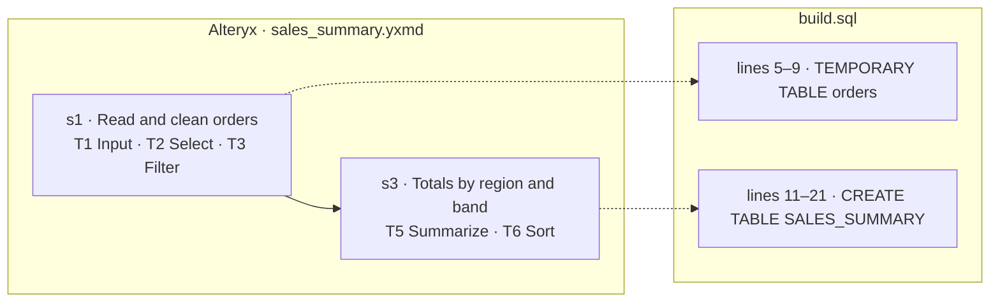

# Objective-first translation — design

Date: 2026-10-06. Status: approved by the project owner in brainstorming, sections 1–3 explicitly, section 4 by
"make changes as you must and get started". This design **supersedes** the segmentation, contract and translation
parts of the original program spec (`docs/spec/00-README.md` §7 "Segmentation, contracts & golden data" and the
segment-shaped parts of §9 and §12, `docs/spec/01-copilot-setup.md`'s per-segment loop). `docs/spec/**` stays
verbatim as the record of the original intent; where it and this document disagree, this document wins.

## 1. Why

The pipeline translated Alteryx workflows tool by tool: `segment.py` cut a workflow into 15–40-tool segments, each
segment became a stored procedure, the translation scaffold wrote one CTE per Alteryx tool, a master procedure called
the segments through work tables, and a dbt target existed beside it. The output was correct but far too large: the
8-tool sample `wf_0001` became 194 lines of SQL (one CTE per tool, each re-listing every column) plus a master
procedure. The owner's direction: **capture what the workflow is for and what its outputs must contain, then write
the minimal SQL — or Python where SQL cannot express it — that produces those outputs.** One file per workflow, no
segment procedures, no master procedure, no work tables, no dbt. Real workflows are often 60–200 tools.

## 2. Decisions (from brainstorming)

| # | Decision |
|---|---|
| D1 | Deliverable: **one file per workflow**, `build.sql` (plain Snowflake SQL: one write statement per output table, CTEs or temporary tables only where they remove repetition or help reading), or `build.py` (one Snowpark module) only when SQL cannot express the logic well. |
| D2 | Workflows of 60–200 tools: a deterministic **digest** (about one line per tool) is what the agents read; the analyzer writes the **objective** from it; the translator writes the file from the objective, consulting the digest for exact expressions. |
| D3 | A person sees only what the analyzer is **unsure** about. Those points (`O1…`) are asked in the same sitting as intake's table-mapping questions. |
| D4 | Approach: **objective-first rebuild**. Segmentation, per-segment contracts, the per-tool translation scaffold, the master procedure, work tables, the chain test and the agent-written dbt target are removed, not kept as a fallback. |
| D9 | **dbt export** (owner, 2026-10-06, amending D4): a SQL workflow is also delivered as a small dbt project, converted by a script from the validated `build.sql` and checked against the same golden data (§4.10). On by default (`mappings/global.yaml` `program.dbt: true`); a Python workflow stays a Snowpark procedure. The translation is still written once, as minimal SQL. |
| D5 | Golden data: captured **inputs and final outputs only**; every output is compared in full. |
| D6 | Traceability: a **generated Mermaid diagram** maps business steps (and the Alteryx tool ids each covers) to line ranges of the file, with a full tool → step → lines table. Every tool must be cited by a step or listed as having no effect on data. |
| D7 | Minimality is checked: a deterministic lint flags pass-through CTEs and tool-by-tool shapes; each flag is fixed or justified in `translation_notes.md`, and the reviewer enforces it. |
| D8 | The refactored project is published as a **new GitHub project** (not a fork: GitHub cannot fork a repository into its own account), carrying the history. The existing public repository is left as it is. Pushing still needs the owner's explicit OK. |

## 3. Flow

| stage | what runs | writes |
|---|---|---|
| parse | `parse.py` (unchanged) | `parsed/dag.json` |
| intake | `intake_touchpoints.py`, `intake_prompt.py`, intake agent (unchanged). **Change:** `WAITING_FOR_ANSWERS` no longer stops the run here — the run continues to analyze, and stops after it with one notice for all questions. `BLOCKED`/`NEEDS_HUMAN` still stop. | `intake/*` |
| analyze | `digest.py`, `objective_scaffold.py --prefill`, analyzer agent, `objective_scaffold.py --apply`, `objective_check.py`, `objective_questions.py --write` | `digest.md`, `objective.json`, `objective.md`, `intake/objective_questions.md` |
| (questions gate) | if intake is `WAITING_FOR_ANSWERS` or the objective has unanswered questions: one notice (GitHub issue when enabled, else the log) naming `intake/open_questions.md` and `intake/objective_questions.md`; analyze is `WAITING_FOR_ANSWERS` while its own questions are open; stop | |
| analyze, resumed | when every `O…` question is answered: one analyzer **revision** session that applies the answers to the objective (same checks), then `DONE` | `objective.json`, `objective.md` |
| golden | `objective_scaffold.py --apply` + `objective_check.py --ready` first (fills `logical` names now intake is READY); then the simulator or the Alteryx capture, **inputs and final outputs only** | `golden/inputs/<set>/`, `golden/outputs/<set>/` |
| translate | loop, at most `maxFixIterations`: translator (iteration 0) or fixer → `compile_check.py` → reviewer → `validate_build.py` (a script; the validator agent is retired). On PASS: `render_mapping.py` | `build.sql`/`build.py`, `translation_notes.md`, `fix_log.md`, `compile_check.json`, `review.json`, `validation*.json`, `docs/mapping.md` |
| document | documenter writes `docs/migration.md` from `objective.md`, `translation_notes.md`, the validation reports and `docs/mapping.md` (which it links, never rewrites) | `docs/migration.md` |
| pr | unchanged; title `migrate(<id>): <tier>, <language>` | |

A tier-T3 objective (the workflow cannot be translated, e.g. an R tool) ends analyze with translate `MANUAL`, as today.

## 4. Files

All paths are under `workflows/<id>/`.

### 4.1 `digest.md` (script: `scripts/digest.py <id>`)

Deterministic, never written by a model. Header with the workflow id, tool count and output count; then one section
per **output** (an Output tool, or any terminal stream), listing the tools upstream of it in topological order; a
tool that feeds several outputs is listed once, in a leading "Shared" section, and referenced by id afterwards. One
line per tool:

```
T3 Filter  [REGION] != "WEST"  ← T2   (T → T5, F → T8)
T4 Formula  AMOUNT = ToNumber([AMOUNT_TXT]); NET = Round([AMOUNT]*IIF([QTY]>=10,0.9,1),0.01); SIZE_BAND = IF … ENDIF  ← T3.T
```

Each line carries the tool id, the canonical type, the configuration that decides behaviour (filter expression,
formula field = expression pairs, join keys and kept anchors, summarize group-bys and actions, sort keys, select
renames/retypes/drops, union mode, unique keys, sample settings, multi-row expressions, cross-tab/transpose keys,
input/output names and write mode, macro name), its annotation when it has one, and its inbound anchors. Long
expressions are kept whole (they are the logic); nothing else is. `scripts/prompt_context.py`'s per-tool summaries
are reused where they already render this.

### 4.2 `objective.json` and `objective.md` (analyzer; mechanical fields by `objective_scaffold.py`)

`objective.json`:

```json
{
  "workflow": "wf_0001",
  "title": "Sales summary by region and size band",
  "purpose": "Totals each region's net order value by size band for the weekly sales review, excluding the WEST region, and lists the excluded orders.",
  "tier": "T1",
  "language": "sql",
  "language_reason": null,
  "inputs": [
    { "tool_id": "1", "logical": "ORDERS",
      "columns": [ { "name": "ORDER_ID", "type": "NUMBER(38,0)", "nullable": true } ],
      "keys": [] }
  ],
  "outputs": [
    { "tool_id": "7", "logical": "SALES_SUMMARY", "write_mode": "overwrite", "pre_sql": null, "post_sql": null,
      "grain": "one row per region and size band",
      "columns": [ { "name": "REGION", "type": "VARCHAR(20)", "nullable": false, "meaning": "sales region" } ],
      "keys": ["REGION", "SIZE_BAND"],
      "row_relation": "aggregate",
      "ordering": { "keys": ["TOTAL_NET", "REGION"], "alteryx_deterministic": true, "order_dependent_columns": [] },
      "tolerances": {}, "normalizations": [] }
  ],
  "steps": [
    { "id": "s1", "name": "Read and clean orders", "does": "…", "tools": ["1", "2", "3"], "feeds": ["s2", "out:8"] }
  ],
  "no_effect": [ { "tool_id": "9", "reason": "Browse tool: displays data, changes nothing" } ],
  "rules": [ "Orders whose region is WEST are left out of the summary and written to EXCLUDED_ORDERS instead." ],
  "parity_risks": [ { "tool_id": "3", "class": "NULL_SEMANTICS", "note": "…" } ],
  "questions": [ { "id": "O1", "tools": ["3"], "question": "…", "assumption": "…" } ],
  "answered": [ { "id": "O1", "question": "…", "answer": "…" } ]
}
```

- **Mechanical** (written by `objective_scaffold.py`, re-applied after the analyzer, never the analyzer's to change):
  `workflow`; each input's `tool_id`, `logical`, column `name`/`type`; each output's `tool_id`, `logical`,
  `write_mode`, `pre_sql`, `post_sql`, column `name`/`type`, and `keys` when the write mode is `update_insert` (from
  `intake/mappings.yaml`). `logical` is `null` until intake has named it. Types come from the parsed RecordInfo the
  same way contract fields did (`contract_scaffold.py`'s derivations are moved, not rewritten).
- **Judgment** (the analyzer's): everything else. `row_relation`, `ordering`, `tolerances`, `normalizations`,
  `parity_risks` keep the meanings and vocabularies the segment contracts gave them (`docs/reference/contracts.md`
  → `docs/reference/objective.md`), because `compare.py` reads them unchanged, now per output.
- `steps[].id` is `s<N>`; `feeds` names steps or `out:<output tool id>`. Every tool id of `parsed/dag.json`
  (macro-internal tools excluded, the macro tool itself included) is in exactly one step's `tools` or in
  `no_effect`.
- `language` is `sql` or `python`; `python` needs a `language_reason`, and a workflow containing a node that
  `parsers.plugin_map.node_class` classes `snowpark` (e.g. the Python tool) must be `python`. A node classed
  `manual` makes the tier `T3`.
- `questions` are the analyzer's unsure points: a filter or constant whose purpose is unclear, an output nobody seems
  to read, an expression that looks like a bug. Each states the assumption the analyzer would make. The analyzer asks
  only what the golden data cannot settle. The revision session moves each answered question to `answered`.

`objective.md` is the human-readable version, with fixed headings: `# <id> — <title>`, `## Purpose`, `## Inputs`,
`## Outputs` (one subsection per output: grain, key, columns and what each means), `## Steps` (one line per step with
its tool ids), `## Business rules`, `## Alteryx behaviour to keep` (the parity risks in words), `## Questions`.

### 4.3 `intake/objective_questions.md` (script: `scripts/objective_questions.py`)

Same box format intake uses, so a person answers both files the same way:

```
# Objective questions - wf_0001
- [ ] O1 - (tools 3) Is excluding the WEST region deliberate, or a leftover test filter?
      Assumed if confirmed: deliberate; WEST orders go to EXCLUDED_ORDERS.
      Answer:
```

An answer is the text after `Answer:` on a ticked item, or `manifest.answers["O1"]`; the file wins when both exist
(the same precedence intake uses). `--write` renders the file from `objective.json` (keeping answers already typed);
`--status` exits 0 when every question is answered, 1 when any is open.

### 4.4 `build.sql` — the deliverable

```sql
-- wf_0001 · Sales summary by region and size band
-- Written from objective.md; checked against golden data. {{src}} = source schema, {{tgt}} = target schema.
ALTER SESSION SET TIMEZONE = 'America/New_York', WEEK_START = 1;

-- step s1, s2
CREATE OR REPLACE TEMPORARY TABLE orders AS
SELECT LEFT(CUSTOMER, 10) AS CUSTOMER, STATUS AS ORDER_STATUS, ORDER_ID, REGION, AMOUNT_TXT, QTY, ORDER_DATE,
       TRY_TO_DOUBLE(AMOUNT_TXT) AS AMOUNT
FROM {{src}}.ORDERS;

-- step s3
CREATE OR REPLACE TABLE {{tgt}}.SALES_SUMMARY AS
SELECT …
FROM orders
WHERE REGION <> 'WEST'
GROUP BY REGION, SIZE_BAND
ORDER BY TOTAL_NET DESC, REGION;

-- step s4
CREATE OR REPLACE TABLE {{tgt}}.EXCLUDED_ORDERS AS
SELECT CUSTOMER, ORDER_STATUS, ORDER_ID, REGION, AMOUNT_TXT, QTY, ORDER_DATE
FROM orders
WHERE NOT (REGION <> 'WEST') OR REGION IS NULL;
```

Rules (each enforced by `compile_check.py`, named in brackets):

- Two placeholders only, `{{src}}` and `{{tgt}}` (spaces inside the braces allowed), each followed by `.<LOGICAL>`
  [`template:placeholder`]. Sources are read only as `{{src}}.<input logical>` and targets written only as
  `{{tgt}}.<output logical>` [`tables:source`, `tables:target`]. A target may be read after it is written, and an
  `append`/`update_insert` target may be read by its own write. Temporary tables use plain unqualified names that
  are not logical names, and are created with `CREATE [OR REPLACE] TEMPORARY TABLE` before use [`tables:temporary`].
- Statements: an optional first `ALTER SESSION SET <param> = <literal>, …` (parameters from the existing session
  allow-list) [`session:form`]; `CREATE [OR REPLACE] [TEMPORARY] TABLE … AS <query>`, `INSERT INTO`, `MERGE INTO`,
  `TRUNCATE TABLE`, `DELETE FROM`, `UPDATE` (the last three only on a target, for a write mode or an Output tool's
  PreSQL/PostSQL). Nothing else: no procedures, `CALL`, `EXECUTE IMMEDIATE`, scripting blocks, `LET`, `DECLARE`
  [`statement:kind`]. No external access (stages, `COPY`, `PUT`, `GET`, file functions, external functions)
  [`external_access`]. Every statement parses with sqlglot's Snowflake dialect [`parse`].
- Each output is written exactly once, in its write mode [`write_mode`]: `overwrite` → `CREATE OR REPLACE TABLE
  {{tgt}}.X AS …`; `append` → `INSERT INTO {{tgt}}.X (…) SELECT …`; `truncate_append` → `TRUNCATE TABLE` (or an
  unconditional `DELETE FROM`) then `INSERT INTO`; `update_insert` → one `MERGE INTO {{tgt}}.X … ON` exactly the
  objective's keys, `WHEN MATCHED THEN UPDATE`, `WHEN NOT MATCHED THEN INSERT`. An Output tool's PreSQL/PostSQL is
  kept as statements immediately before/after its write [`write_mode:pre_post`].
- Step markers: a comment line `-- step s1` or `-- step s1, s3` starts a region that runs to the line before the
  next marker or the end of the file. Every step of the objective has at least one region; a marker naming an
  unknown step is refused [`steps:missing`, `steps:unknown`].
- Running on an empty sandbox (input tables created empty from the objective's input columns) succeeds and leaves
  every output table with exactly the objective's column names [`run`, `outputs:columns`].

**Running it on Snowflake.** One Snowflake Task runs
`EXECUTE IMMEDIATE FROM @<stage>/build.sql USING (src => '<DB>.<SCHEMA>', tgt => '<DB>.<SCHEMA>')`, which renders
`{{src}}`/`{{tgt}}` with Snowflake's own templating. Nothing in this repo has run on a real account: `deploy.py`
prints that form and, with `--render`, also writes `build.rendered.sql` with the names substituted, for an account
where the templated form does not run. The source schema is the view schema `gen_source_views.py` generates
(`<DB>.MIG_SRC_<WF>`, one view per logical source), so the file never names a production table.

### 4.5 `build.py` — only when SQL will not do

One Snowpark module: `def main(session, src: str, tgt: str) -> str`, reading `session.table(f"{src}.<LOGICAL>")`,
writing `<df>.write.save_as_table(f"{tgt}.<LOGICAL>", mode=…)` (or the `MERGE` form for `update_insert`, as today's
Snowpark rules require), returning `"OK"`; `# step s1` markers as in SQL. The existing Snowpark static rules and
runtime sandbox (`lib/snowpark_rules.py`, `lib/snowpark_sandbox.py`) apply with the new signature. `deploy.py`
wraps it in one Python stored procedure (handler `main`).

### 4.6 `compile_check.json`

```json
{ "ok": false,
  "errors": [ "write_mode: SALES_SUMMARY is overwrite, so it is written as CREATE OR REPLACE TABLE {{tgt}}.SALES_SUMMARY AS …; found INSERT INTO at line 14" ],
  "lint": { "lines": 31, "statements": 4, "ctes": 1,
            "flags": [ { "kind": "pass_through_cte", "name": "t2", "line": 9,
                         "note": "only selects or renames columns of t1; inline it" } ] } }
```

Lint flags (`lib/minimality.py`, SQL only), never errors by themselves:
- `pass_through_cte` — a CTE (or temporary table) whose query is a projection of bare or renamed columns from one
  relation with no `WHERE`, `GROUP BY`, `HAVING`, `QUALIFY`, `JOIN`, `DISTINCT`, window, `ORDER BY` or `LIMIT`,
  or `SELECT *` from one relation.
- `tool_by_tool` — at least 4 CTEs and as many CTEs as the objective has non-input/output tools: the shape of a
  per-tool translation.
- `single_use_chain` — three or more CTEs in a row each read only by the next, none filtering, grouping or joining.

The translator (and fixer) fixes each flag or adds a line `lint <kind> <name>: kept because …` to
`translation_notes.md`; the reviewer blocks a flag that is neither.

### 4.7 `review.json`

`{ "verdict": "PASS" | "BLOCK", "findings": [ { "severity": "blocker" | "note", "where": "build.sql:14", "text": "…" } ] }`.
The reviewer reads `build.*`, `objective.json`/`objective.md`, `translation_notes.md`, `compile_check.json` and the
cookbook pages for the tool types present; never the golden data. It blocks on: a business rule or parity risk the
file does not honour, an output that does not match its objective entry, an unjustified `language: python`, an
unresolved lint flag, a step whose region does not do what the step says.

### 4.8 `validation.json` and `validation.<set>.json` (script: `scripts/validate_build.py <id>`)

For each golden set: a fresh in-memory DuckDB backend; `load_golden.load_set` (sources as views under the set's view
schema, `targets_before` under `MIGDB.MIG_WORK`); render `{{src}}` = the view schema, `{{tgt}}` = `MIGDB.MIG_WORK`;
run each statement; compare every objective output with its golden output through `compare.compare`, giving it the
objective converted per output into the contract shape it already reads (`lib/objective.py: contract_view`). The
set's verdict is the worst output verdict; `needs_human` if any output says so. Idempotency: the first set is run
twice from scratch and every output must hold the same rows both times. `build.py` runs in the Snowpark Local
Testing Framework inside the existing sandbox, compared the same way. `--backend snowflake` stays for a person. The
report shape is today's segment report without the `segment` key, plus `"language"`.

### 4.9 `docs/mapping.md` (script: `scripts/render_mapping.py <id>`)

Generated from `objective.json`, the step markers in `build.*` and `parsed/dag.json`:

````markdown
# wf_0001 — how the Alteryx workflow maps to build.sql



| tool | type | what it does | step | lines |
|---|---|---|---|---|
| T3 | Filter | `[REGION] != "WEST"` | s1 | 5–9 |
| T9 | Browse | — | no effect: Browse tool | — |
````

Labels are escaped for Mermaid (quotes, `#`, `;`, `<`/`>` other than `<br/>`), node ids are generated, and the block
passes the same lint as the README's diagrams (shared helper `scripts/lib/mermaid_lint.py`). Exit 1 if a step has no
region or a tool is unaccounted for.

### 4.10 `dbt/` — the dbt export (scripts: `scripts/export_dbt.py <id>`, `scripts/validate_dbt.py <id>`)

Written by code from the validated `build.sql`, never by an agent. Skipped (exit 0, a line saying why, nothing
written, any old `dbt/` removed) when `program.dbt` is false or the workflow's language is `python`.

```
workflows/<id>/dbt/
  dbt_project.yml        name mig_<wf>, model-paths [models]; the build's ALTER SESSION (if any) as a project-level
                         +pre-hook of the models, guarded  (it renders to nothing on
                         DuckDB), so it runs on each model's own connection before its SQL: dbt runs on-run-start on its
                         master connection, never on a model's, so that hook would set nothing
  profiles.yml           a local DuckDB target for validation; a commented Snowflake target with placeholders only
  README.md              how to run it (dbt build --project-dir …), what each model is, that nothing ran on Snowflake
  models/sources.yml     source "<wf>" with one table per objective input logical; schema from var('src_schema')
  models/schema.yml      one entry per output model: columns (name, description = the objective's meaning),
                         tests: not_null for every NOT NULL column, unique for a one-column key
  models/<logical lower>.sql   one per output
  models/<temp name>.sql       one per temporary table, materialized ephemeral
```

Conversion, statement by statement (the forms `compile_check.py` already enforces):

| `build.sql` statement | model |
|---|---|
| `CREATE OR REPLACE TEMPORARY TABLE t AS <query>` | `models/t.sql`, `{{ config(materialized='ephemeral') }}`, body `<query>` |
| `CREATE OR REPLACE TABLE {{tgt}}.X AS <query>` (overwrite) | `models/x.sql`, `materialized='table'` |
| `INSERT INTO {{tgt}}.X (…) SELECT …` (append) | `materialized='incremental'`, `incremental_strategy='append'`, `full_refresh=false` (so `dbt build --full-refresh` cannot wipe the history) |
| `TRUNCATE TABLE {{tgt}}.X` + `INSERT INTO {{tgt}}.X …` (truncate_append) | `materialized='table'` (the table is replaced each run) |
| `MERGE INTO {{tgt}}.X USING (<query>) s ON <keys> …` (update_insert) | `materialized='incremental'`, `incremental_strategy='merge'`, `full_refresh=false`, `unique_key=[keys]`, body `<query>` |
| an Output tool's PreSQL / PostSQL around a write | that model's `pre_hook` / `post_hook` (one that reads a temporary table has no dbt form: a hook gets no CTE for an ephemeral model) |

In every body, `{{src}}.X` becomes `{{ source('<wf>', 'X') }}`, a temporary table `t` becomes `{{ ref('t') }}`, and a
target `{{tgt}}.Y` read after it is written becomes `{{ ref('y') }}`. Step markers are kept as comments at the top of
each model. Any other statement shape is exit 1 naming its line ("no dbt form for …"); exit 2 for usage errors.
`validate_dbt.py` runs the project with dbt-duckdb against every golden set (the existing runner,
`lib/dbt_project.run_dbt`) and compares each output model with `compare.py` through `contract_view`, writing
`dbt/validation.json` in the same shape as §4.8, idempotency included. The orchestrator runs both after
`render_mapping.py`: `export_dbt.py` exit 1 or `validate_dbt.py` exit 1 → translate `NEEDS_HUMAN` with reason
`dbt: <first line>`; exit 2 → `script-error`. `deploy.py --dbt` prints the dbt command for the human's Snowflake
profile instead of the build-file deployment.

## 5. Agents

| role | reads | writes | change |
|---|---|---|---|
| intake | as today | `intake/*` | none |
| analyzer | `digest.md` (inline when it fits, else by path), `parsed/dag.json` for detail, `intake/mappings.yaml`, `cookbook/` | `objective.json`, `objective.md`, `notes/analyzer.md` | rewritten: writes the objective; runs `objective_check.py` before finishing |
| translator | `objective.json`/`.md`, `digest.md`, answered questions, the cookbook pages for the tool types present | `build.sql` or `build.py`, `translation_notes.md` | rewritten: one minimal file; may run `compile_check.py` and `validate_build.py` once each to test its own work |
| reviewer | as §4.7 | `review.json` | rewritten |
| fixer | `validation.json`, `review.json`, `compile_check.json`, the objective, the file | `build.*`, `translation_notes.md`, `fix_log.md`, `notes/fixer.md` | whole file instead of a segment |
| documenter | as §3 | `docs/migration.md` | sources changed |
| parser-recovery | unchanged | unchanged | none |
| validator | — | — | **retired**: `validate_build.py` is run by the orchestrator, as code |

The translator keeps every parity rule of today's agent file that is about Alteryx behaviour (NULL to the Filter's
False side, `TRY_TO_*` where Alteryx warns and nulls, `LEFT(x, n)` for `String(n)`, money in `NUMBER` before
`ROUND`, explicit `ORDER BY` for order-dependent tools, write-mode forms) and drops every rule about procedure shape,
`LET`/`IDENTIFIER`, CTE-per-tool naming and skeletons. The cookbook's per-tool "Snowflake pattern" sections become
expression references, not a structure to copy (said once in `cookbook/index.md`); `cookbook/dbt.md` goes.

Session rules (`SESSION_RULE_LINES`) stay; rule 5's "the contract" becomes "the objective", rule 6's "the contract
describes every column" becomes "the objective describes every column".

## 6. What is removed

Scripts: `segment.py`, `plan_batches.py`, `stitch_analysis.py`, `check_seams.py`, `contract_scaffold.py` (its
derivations move into `objective_scaffold.py`), `contract_check.py`, `translation_scaffold.py`, `render_snowpark.py`,
`target_check.py` (`node_class` stays in `parsers/plugin_map.py`), `validate_segment.py`, `validate_workflow.py`,
`validate_snowpark.py` and `validate_dbt.py` (into `validate_build.py`), `lib/proc_runner.py` (its statement
splitter and masking move to `lib/build_sql.py`), `lib/scaffold.py`, `lib/dbt_surface.py` (the closed surface existed because agents wrote dbt files; a script writes them now), the old agent-facing parts of `lib/dbt_project.py` (its runner stays, §4.10),
`lib/handoff.py`, `scripts/dev/segment_scale.py`; `prompt_context.py` keeps only the intake role. The
`output_target`/`output_kind` choice (procedures vs dbt), `segments/`, `procs/`, `analysis.md`, `unsupported.json`
and the manifest's `segments`, `segment_status`, `segmentation`, `output_kind` go. `intake_prompt.py` no longer asks
for an output target. Orchestrator: segment loops, batches, seams, contract re-application, the chain check,
`masterSql`, every dbt path and the dbt write lanes. Agent file `validator.agent.md`. Docs: `docs/reference/contracts.md`,
`large-workflows.md` and `output-targets.md` are replaced by `docs/reference/objective.md` and
`docs/reference/build-file.md`.

Kept as they are: parsing and parser recovery, intake, `compare.py` (inputs now from `contract_view`), the golden
loader, the DuckDB and Snowflake backends, the Snowpark rules and sandbox (new signature), the orchestrator's runners,
policy engine, hooks, graded denials, budgets, session rules and timeouts, `gen_source_views.py`, the cookbook's
behaviour and parity sections, `survey_corpus.py` (minus its dbt preference).

## 7. Testing

- Every new script has unit tests on the seven samples and on small fixtures; the samples' `canned/` trees are
  rewritten to the new artifacts (`objective.json`, `objective.md`, `build.sql` or `build.py`,
  `translation_notes.md`, `review.json`, `docs/migration.md`, `intake/plan.md`), each canned build passing
  `compile_check.py` with no unresolved lint flag and `validate_build.py` on every golden set; `broken_sql/` becomes
  `broken/` with whole-file broken variants for the fixer scenarios.
- The orchestrator's tests drive the new stage flow with fakes, and the integration test runs `wf_0001` end to end
  with the MockRunner (including one fixer round from a broken canned build).
- A live run of the samples with a real model (the Sonnet stand-in through `--runner external`, and the local model
  where time allows) closes the work; its results go into `docs/live-smoke-test.md` as the "Fifth live test".
- Suites: `node --test`, `tsc --noEmit`, `pytest` all green; no skipped tests.

## 8. Risks

- Without segment cut points a mismatch is not localised to a piece of the workflow; the fixer gets the
  comparison's column/row clusters and each affected column's step. Golden captures at chosen steps can be added
  later if this proves too weak.
- A 200-tool digest is about 10–15k tokens; a workflow beyond the analyzer's budget is described output by output
  (the digest's sections), in one session when it fits and otherwise by path, which the analyzer reads section by
  section. No batching machinery is built until a real workflow needs it.
- Snowflake's templated `EXECUTE IMMEDIATE FROM … USING` is unverified here; `deploy.py --render` is the fallback.
