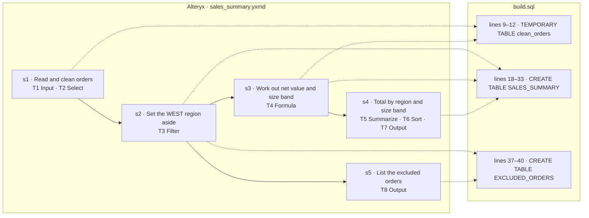

# wf_0001 — how the Alteryx workflow maps to build.sql

_Generated by `scripts/render_mapping.py` from `objective.json`, the `-- step` markers in `build.sql` and `parsed/dag.json`. Do not edit it: the line numbers are those of `build.sql` when it was rendered._

| tool | type | what it does | step | lines |
|---|---|---|---|---|
| T1 | Input | `read orders.yxdb (yxdb)` | s1 | 9–12 |
| T2 | Select | `CUSTOMER:String(10); STATUS → ORDER_STATUS; other fields kept` | s1 | 9–12 |
| T3 | Filter | `[REGION] != "WEST"` | s2 | 18–33, 37–40 |
| T4 | Formula | `AMOUNT:Double = ToNumber([AMOUNT_TXT]); NET:Double = Round([AMOUNT] * IIF([QTY] >= 10, 0.9, 1), 0.01); SIZE_BAND:V_Stri…` | s3 | 9–12, 18–33 |
| T5 | Summarize | `group by REGION, SIZE_BAND; Sum(NET) as TOTAL_NET; Count(ORDER_ID) as ORDERS; CountNonNull(AMOUNT) as PRICED_ORDERS; Ma…` | s4 | 18–33 |
| T6 | Sort | `TOTAL_NET desc, REGION asc` | s4 | 18–33 |
| T7 | Output | `write sales_summary.yxdb (yxdb), mode overwrite` | s4 | 18–33 |
| T8 | Output | `write excluded_orders.csv (csv), mode overwrite` | s5 | 37–40 |
