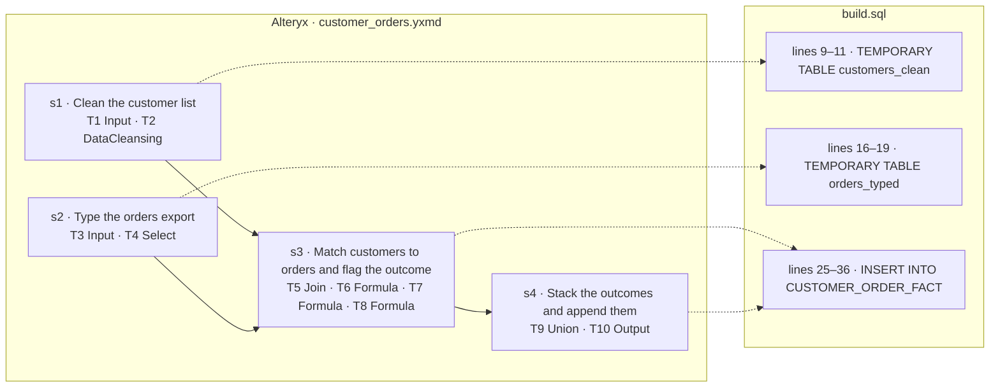

# wf_0002 — how the Alteryx workflow maps to build.sql

_Generated by `scripts/render_mapping.py` from `objective.json`, the `-- step` markers in `build.sql` and `parsed/dag.json`. Do not edit it: the line numbers are those of `build.sql` when it was rendered._

| tool | type | what it does | step | lines |
|---|---|---|---|---|
| T1 | Input | `read customers.yxdb (yxdb)` | s1 | 9–11 |
| T2 | DataCleansing | `fields NAME, CITY: replace null text with blank, trim whitespace, upper case` | s1 | 9–11 |
| T3 | Input | `read orders_export.csv (csv, delimiter ",", header row, codepage 28591)` | s2 | 16–19 |
| T4 | Select | `ORDER_ID:Int32; CUST_ID:Int32; AMOUNT:Double; ORDER_DATE:Date; other fields dropped` | s2 | 16–19 |
| T5 | Join | `on Left.CUST_ID = Right.CUST_ID; drop Right_CUST_ID` | s3 | 25–36 |
| T6 | Formula | `MATCH_FLAG:V_String(12) = "MATCHED"` | s3 | 25–36 |
| T7 | Formula | `MATCH_FLAG:V_String(12) = "NO_ORDERS"` | s3 | 25–36 |
| T8 | Formula | `MATCH_FLAG:V_String(12) = "ORPHAN"` | s3 | 25–36 |
| T9 | Union | `by name` | s4 | 25–36 |
| T10 | Output | `write db:dw_sales table dbo.CUSTOMER_ORDER_FACT, mode append` | s4 | 25–36 |
| T11 | Browse | — | no effect: Browse tool: shows the stacked rows to a person, changes nothing | — |
| T100 | Container | — | no effect: Container tool: carries no data | — |
| T200 | Container | — | no effect: Container tool: carries no data | — |
| T210 | Container | — | no effect: Container tool: carries no data | — |
| T300 | Comment | — | no effect: Comment tool: carries no data | — |
