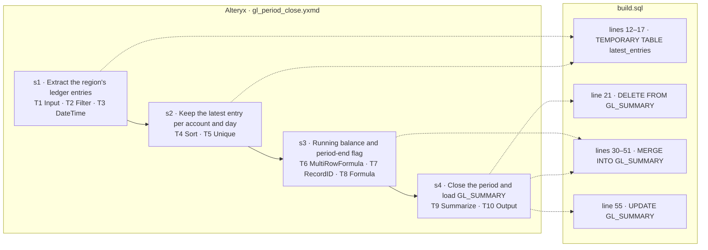

# wf_0003 — how the Alteryx workflow maps to build.sql

_Generated by `scripts/render_mapping.py` from `objective.json`, the `-- step` markers in `build.sql` and `parsed/dag.json`. Do not edit it: the line numbers are those of `build.sql` when it was rendered._

| tool | type | what it does | step | lines |
|---|---|---|---|---|
| T1 | Input | `read db:prod_fin; query: SELECT ACCT, PERIOD, POSTED, AMOUNT, REGION, ENTRY_ID FROM dbo.GL_LEDGER WHERE AMOUNT <> 0` | s1 | 12–17 |
| T2 | Filter | `[REGION] = [User.Region]` | s1 | 12–17 |
| T3 | DateTime | `to_datetime POSTED with format "%d/%m/%Y" → POSTED_DT` | s1 | 12–17 |
| T4 | Sort | `ACCT asc, POSTED_DT asc, ENTRY_ID desc` | s2 | 12–17 |
| T5 | Unique | `keys ACCT, POSTED_DT` | s2 | 12–17 |
| T6 | MultiRowFormula | `new field RUN_BAL:Double = [Row-1:RUN_BAL] + [AMOUNT]; rows 1; group by ACCT; missing rows → zero` | s3 | 30–51 |
| T7 | RecordID | `new field RecordID:Int32 starting at 1, position first` | s3 | 30–51 |
| T8 | Formula | `PERIOD_END_FLAG:V_String(1) = IIF(DateTimeFormat([POSTED_DT], "%Y-%m-%d") = [User.PeriodEnd], "Y", "N")` | s3 | 30–51 |
| T9 | Summarize | `group by ACCT, PERIOD; Sum(AMOUNT) as TOTAL; Last(RUN_BAL) as CLOSING_BAL; Count(ENTRY_ID) as ENTRIES; Max(PERIOD_END_F…` | s4 | 21, 30–51, 55 |
| T10 | Output | `write db:prod_fin table dbo.GL_SUMMARY, mode update_insert, keys ACCT, PERIOD; PreSQL: DELETE FROM dbo.GL_SUMMARY WHERE…` | s4 | 21, 30–51, 55 |
| T100 | Container | — | no effect: Container tool: carries no data | — |
| T200 | Container | — | no effect: Container tool: carries no data | — |
