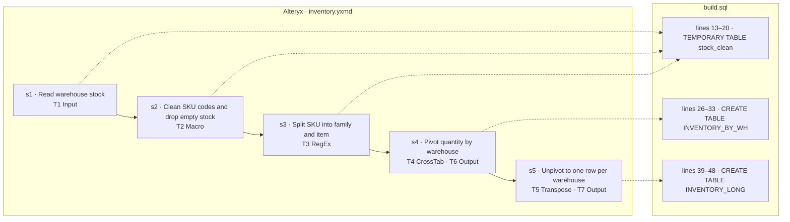

# wf_0004 — how the Alteryx workflow maps to build.sql

_Generated by `scripts/render_mapping.py` from `objective.json`, the `-- step` markers in `build.sql` and `parsed/dag.json`. Do not edit it: the line numbers are those of `build.sql` when it was rendered._

| tool | type | what it does | step | lines |
|---|---|---|---|---|
| T1 | Input | `read stock.yxdb (yxdb)` | s1 | 13–20 |
| T2 | Macro | `clean_codes.yxmc; MinQty = 1 (default 0)` | s2 | 13–20 |
| T3 | RegEx | `parse on SKU: expression "^([A-Z]+)-(\d+)$"; case-sensitive; output fields FAMILY:V_String(20), ITEM_NO:V_String(10)` | s3 | 13–20 |
| T4 | CrossTab | `group by SKU, FAMILY; header WAREHOUSE; data QTY; methods Sum` | s4 | 26–33 |
| T5 | Transpose | `key fields SKU; data fields EAST, NORTH, WEST` | s5 | 39–48 |
| T6 | Output | `write inventory_by_wh.yxdb (yxdb), mode overwrite` | s4 | 26–33 |
| T7 | Output | `write inventory_long.yxdb (yxdb), mode overwrite` | s5 | 39–48 |
