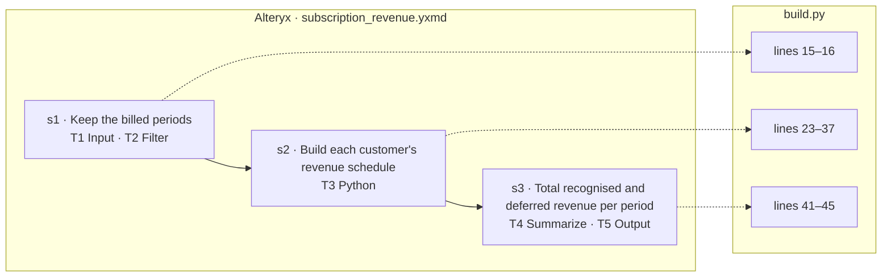

# wf_0006 — how the Alteryx workflow maps to build.py

_Generated by `scripts/render_mapping.py` from `objective.json`, the `# step` markers in `build.py` and `parsed/dag.json`. Do not edit it: the line numbers are those of `build.py` when it was rendered._

| tool | type | what it does | step | lines |
|---|---|---|---|---|
| T1 | Input | `read subscriptions.yxdb (yxdb)` | s1 | 15–16 |
| T2 | Filter | `[BILLED] > 0` | s1 | 15–16 |
| T3 | Python | `script: import pandas as pd\ndf = Alteryx.read("#1")\ndf = df.sort_values(["CUSTOMER", "PERIOD"]).reset_index(drop=True…` | s2 | 23–37 |
| T4 | Summarize | `group by PERIOD; Sum(RECOGNIZED) as TOTAL_RECOGNIZED; Sum(DEFERRED) as TOTAL_DEFERRED; Count(CUSTOMER) as CUSTOMERS` | s3 | 41–45 |
| T5 | Output | `write revenue_by_period.yxdb (yxdb), mode overwrite` | s3 | 41–45 |
