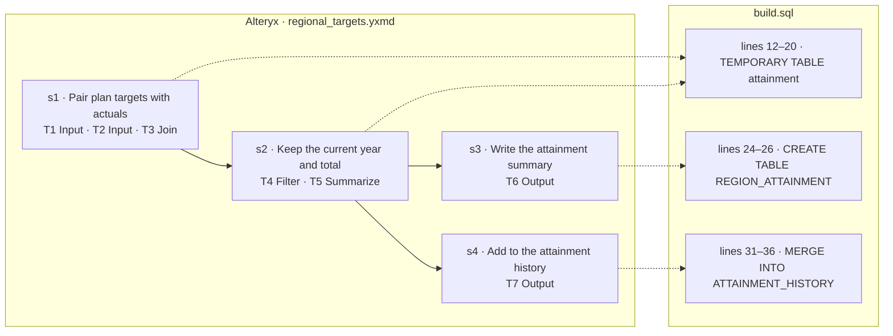

# wf_0007 — how the Alteryx workflow maps to build.sql

_Generated by `scripts/render_mapping.py` from `objective.json`, the `-- step` markers in `build.sql` and `parsed/dag.json`. Do not edit it: the line numbers are those of `build.sql` when it was rendered._

| tool | type | what it does | step | lines |
|---|---|---|---|---|
| T1 | Input | `read targets.yxdb (yxdb)` | s1 | 12–20 |
| T2 | Input | `read actuals.yxdb (yxdb)` | s1 | 12–20 |
| T3 | Join | `on Left.REGION = Right.REGION and Left.PERIOD = Right.PERIOD; drop Right_REGION, Right_PERIOD` | s1 | 12–20 |
| T4 | Filter | `Left([PERIOD], 4) = [User.CurrentYear]` | s2 | 12–20 |
| T5 | Summarize | `group by REGION, PERIOD; Sum(TARGET) as TARGET_TOTAL; Sum(ACTUAL) as ACTUAL_TOTAL; Count(REGION) as LINES` | s2 | 12–20 |
| T6 | Output | `write region_attainment.yxdb (yxdb), mode overwrite` | s3 | 24–26 |
| T7 | Output | `write db:prod_plan table dbo.ATTAINMENT_HISTORY, mode update_insert, keys REGION, PERIOD` | s4 | 31–36 |
| T10 | Container | — | no effect: Container tool: carries no data | — |
| T11 | Container | — | no effect: Container tool: carries no data | — |
